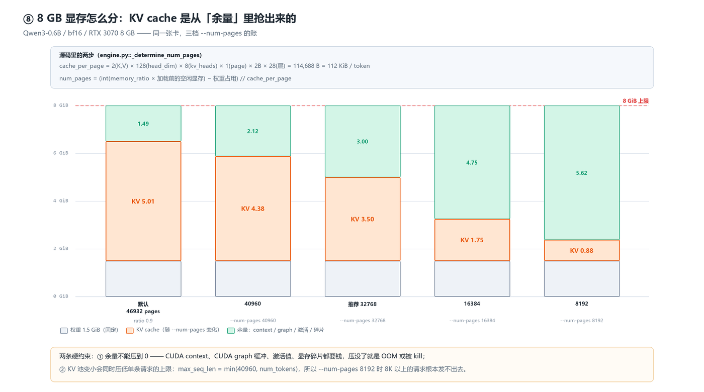
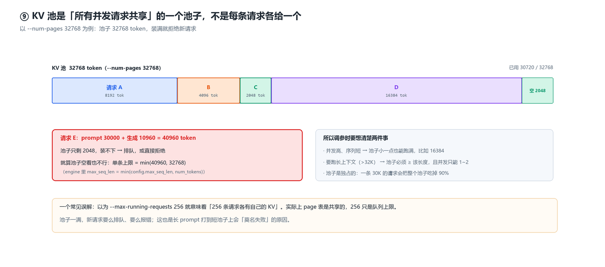

# WSL Ubuntu 24.04 + mini-sglang 环境配置与运行指南

> 本文档记录本机（Windows + WSL2）从零搭建 CUDA + uv + mini-sglang 推理环境的**完整实测流程**，
> 所有命令均已实际执行验证通过。
> 踩坑记录已单独成篇，见同目录《踩坑记录.md》。

- 生成时间：2026-10-22
- 适用环境：Windows 11 (build 26200.9457) / WSL 3.0.3 / Ubuntu 24.04.5 LTS
- 目标项目：<https://github.com/sgl-project/mini-sglang>（SGLang 的轻量教学版，约 5000 行 Python）

---

## 0. 环境总览

| 项目 | 值 |
|---|---|
| 操作系统 | Windows 11 (10.0.26200.9457) |
| WSL 引擎 | WSL 3.0.3，内核 `6.18.54.1-microsoft-standard-WSL2` |
| 发行版 | Ubuntu 24.04.5 LTS (noble) |
| GPU | NVIDIA GeForce RTX 3070，8 GB，compute capability **8.6 (sm_86)** |
| 显卡驱动 | 560.94（驱动自带 CUDA 12.6 runtime） |
| CUDA Toolkit | **12.8.93**（含 nvcc，本文档安装） |
| CPU / 内存 / 磁盘 | 16 核 / 15 GiB / 约 950 GB 可用 |

> ⚠️ **显存是主要瓶颈**：8 GB 显存下 KV cache 最多只能分到约 5 GB，
> 适合跑 0.6B ~ 1.7B 级别的小模型（如 Qwen3-0.6B）。跑不动 7B 以上的模型。

### 目录约定

| 路径 | 用途 |
|---|---|
| `~/workspace/mini-sglang` | **主工作副本**，源码 + `.venv` 虚拟环境 + `start.sh` / `pull-model.sh` / `stop.sh` |
| `~/models/` | **本地模型目录**（软链指向 modelscope 缓存），启动时用这个路径 = 完全离线 |
| `D:\Codes\mini-sglang` | Windows 侧镜像副本（用 IDE 编辑代码时用） |
| `~/.venvs/minisgl` | 早期建立的第二套 venv（指向 D 盘副本），可保留 |
| `~/.cache/modelscope` | modelscope 权重缓存（`~/models/` 的软链指向这里） |
| `~/.cache/flashinfer` | FlashInfer JIT 编译缓存（**不要删，删了要重编译几分钟**） |

---

## 1. 安装 WSL 与 Ubuntu 24.04

### 1.1 启用 Windows 功能（管理员 PowerShell）

```powershell
dism.exe /online /enable-feature /featurename:Microsoft-Windows-Subsystem-Linux --all /norestart
dism.exe /online /enable-feature /featurename:VirtualMachinePlatform --all /norestart
Restart-Computer
```

### 1.2 安装发行版

```powershell
wsl --install -d Ubuntu-24.04
```

若在国内网络下载失败，**不要用 `wsl --install` 默认源**（它走 GitHub，极慢）。实测可用的方案是手动下载 `.wsl` 双击包：

```powershell
# 清华镜像目录（ubuntu-releases，不是 ubuntu-cloud-images）
Invoke-WebRequest -Uri "https://mirrors.tuna.tsinghua.edu.cn/ubuntu-releases/noble/" -OutFile "$env:TEMP\noble.html"
# 从列表里挑最新的 ubuntu-<版本>-wsl-amd64.wsl 下载，然后：
wsl --install --from-file "<下载的.wsl文件>" --name Ubuntu-24.04 --location "<安装目录>"
```

> `--from-file` 在微软 basic-commands 官方文档里**未收录**，用 `wsl --help` 自行确认。
> 注意：`wsl --install --from-file` 在**非交互 shell** 里会永久卡住（等 OOBE 建用户名），
> 但发行版其实已装好 —— 杀掉 install 进程、`wsl --terminate <名字>` 即可正常使用。

### 1.3 验证

```powershell
wsl --version
wsl -l -v
```

---

## 2. 基础环境准备

### 2.1 换国内 apt 源（清华）

Ubuntu 24.04 用的是 **deb822 格式**，主文件在 `/etc/apt/sources.list.d/ubuntu.sources`（不是老教程里的 `sources.list`）。

```bash
sudo cp /etc/apt/sources.list.d/ubuntu.sources{,.bak}
sudo sed -i 's|http://archive.ubuntu.com/ubuntu/|https://mirrors.tuna.tsinghua.edu.cn/ubuntu/|g; \
            s|http://security.ubuntu.com/ubuntu/|https://mirrors.tuna.tsinghua.edu.cn/ubuntu/|g' \
     /etc/apt/sources.list.d/ubuntu.sources
sudo apt-get update
```

### 2.2 基础编译工具

```bash
sudo apt-get install -y build-essential python3-pip python3-venv pkg-config ca-certificates git curl wget
```

验证：

```bash
gcc --version && make --version && python3 -V && git --version
```

### 2.3 pip 换清华镜像

**默认 `pypi.org` 在国内极慢**（实测 16 MB 的 numpy wheel 超过 60 秒仍未完成），必须换源。

```bash
mkdir -p ~/.config/pip
cat > ~/.config/pip/pip.conf <<'EOF'
[global]
index-url = https://pypi.tuna.tsinghua.edu.cn/simple
trusted-host = pypi.tuna.tsinghua.edu.cn
timeout = 60
EOF
cp ~/.config/pip/pip.conf ~/.pip/pip.conf   # 旧路径也放一份更保险
```

> ⚠️ **pip 只读当前用户 HOME 下的配置**。用 `wsl -u root` 跑 pip 不会读普通用户的 `pip.conf`，
> 会回落到 pypi.org —— 测速时务必用普通用户跑，否则会误判「镜像没生效」。

---

## 3. 安装 uv（Python 包 / 虚拟环境管理器）

官方独立安装器（不依赖系统 Python，装到 `~/.local/bin`）：

```bash
curl -LsSf https://astral.sh/uv/install.sh | sh
```

验证：

```bash
uv --version          # uv 0.13.5 (x86_64-unknown-linux-gnu)
```

把 uv 与国内镜像源写进 shell 配置（`~/.bashrc`）：

```bash
export PATH="$HOME/.local/bin:$PATH"
export UV_DEFAULT_INDEX="https://pypi.tuna.tsinghua.edu.cn/simple"
export UV_INDEX_STRATEGY="unsafe-best-match"
export UV_HTTP_TIMEOUT=120
```

常用命令：

```bash
uv venv --python=3.12 .venv          # 建虚拟环境
uv pip install -e .                   # 装项目依赖（走清华镜像）
uv pip list                           # 看已装包
uv run <cmd>                          # 免激活直接跑
```

---

## 4. 安装 CUDA Toolkit（nvcc）

> **为什么必须装**：mini-sglang 依赖 `flashinfer` 的 **JIT 编译 CUDA kernel**，
> 运行时要用 `nvcc` 现场编译。只装 PyTorch 的 pip wheel **不够**（wheel 只带运行时库，不带编译器）。
> 另外 README 明确要求 toolkit 版本与驱动匹配。

### 4.1 加 NVIDIA 官方 apt 源

```bash
cd /tmp
curl -sSLO https://developer.download.nvidia.com/compute/cuda/repos/ubuntu2404/x86_64/cuda-keyring_1.1-1_all.deb
sudo dpkg -i cuda-keyring_1.1-1_all.deb
sudo apt-get update
```

### 4.2 安装 toolkit

```bash
sudo apt-get install -y cuda-toolkit-12-8
```

> 用 `cuda-toolkit-12-8` 而不是 `cuda` 元包：后者会额外拖进 Linux 显卡驱动，
> 在 WSL 里**不需要**（驱动由 Windows 侧提供）。

实测该源速度 **11 MB/s**，安装约 3–5 分钟。

### 4.3 建立软链并写进 shell 配置

```bash
sudo ln -sfn /usr/local/cuda-12.8 /usr/local/cuda

sudo tee /etc/profile.d/cuda.sh >/dev/null <<'EOF'
export CUDA_HOME=/usr/local/cuda
export PATH=$CUDA_HOME/bin:$PATH
export LD_LIBRARY_PATH=$CUDA_HOME/lib64:$LD_LIBRARY_PATH
EOF
sudo chmod 644 /etc/profile.d/cuda.sh
```

### 4.4 验证（编译 + 运行一个真实的 CUDA 程序）

```bash
cat > /tmp/t.cu <<'EOF'
#include <cstdio>
__global__ void k(float* o){ o[threadIdx.x] = threadIdx.x * 2.0f; }
int main(){
  float* d; cudaMalloc(&d, 4*sizeof(float));
  k<<<1,4>>>(d);
  float h[4]; cudaMemcpy(h,d,4*sizeof(float),cudaMemcpyDeviceToHost);
  printf("cuda ok: %.1f %.1f %.1f %.1f\n",h[0],h[1],h[2],h[3]);
}
EOF
nvcc -arch=sm_86 -o /tmp/t /tmp/t.cu && /tmp/t
# 期望输出: cuda ok: 0.0 2.0 4.0 6.0
```

### 4.5 安装 ninja

FlashInfer 的 JIT 用 ninja 驱动编译，**ninja 必须在 PATH 上**：

```bash
sudo apt-get install -y ninja-build
ninja --version       # 1.11.1
```

---

## 5. 部署 mini-sglang

### 5.1 克隆（国内走 gh-proxy 加速）

```bash
mkdir -p ~/workspace && cd ~/workspace
git clone https://gh-proxy.com/https://github.com/sgl-project/mini-sglang.git
cd mini-sglang
```

### 5.2 建虚拟环境并装依赖

```bash
cd ~/workspace/mini-sglang
uv venv --python=3.12 .venv
source .venv/bin/activate
uv pip install -e .
```

实测版本组合（全部兼容）：

| 包 | 版本 |
|---|---|
| torch | 2.9.1+cu128 |
| sgl-kernel | 0.3.21 |
| flashinfer-python | 0.7.2 |
| quack-kernels | 0.6.5 |
| apache-tvm-ffi | 0.1.15.post0 |
| transformers | 4.57.3 |
| accelerate | 1.15.0 |
| triton | 3.5.1 |

耗时参考：首次（冷缓存）约 **4 分钟**；uv 缓存热之后重建只要 **19 秒**。

### 5.3 环境变量统一写进 `~/.bashrc`

**不要在启动脚本里写环境变量**，全部集中到 shell 配置，新开终端自动生效：

```bash
# 把下面整块加到 ~/.bashrc 的【最前面】(见 5.4)
# --- CUDA Toolkit 12.8（系统级另见 /etc/profile.d/cuda.sh）---
export CUDA_HOME=/usr/local/cuda
export PATH=$CUDA_HOME/bin:$PATH
export LD_LIBRARY_PATH=$CUDA_HOME/lib64:$LD_LIBRARY_PATH

# --- uv ---
export PATH="$HOME/.local/bin:$PATH"
export UV_DEFAULT_INDEX="https://pypi.tuna.tsinghua.edu.cn/simple"
export UV_INDEX_STRATEGY="unsafe-best-match"
export UV_HTTP_TIMEOUT=120

# --- HuggingFace 国内镜像 ---
export HF_ENDPOINT="https://hf-mirror.com"
export HF_HUB_DISABLE_TELEMETRY=1
export HF_HUB_ENABLE_HF_TRANSFER=0
export TOKENIZERS_PARALLELISM=false

# --- ModelScope（--model-source modelscope 用）---
export MODELSCOPE_CACHE="$HOME/.cache/modelscope"

# --- 编译目标与缓存目录 ---
export TORCH_CUDA_ARCH_LIST="8.6"          # 本机 RTX 3070 = sm_86，限定后 JIT 更快
export FLASHINFER_WORKSPACE_BASE="$HOME/.cache/flashinfer"
export TRITON_CACHE_DIR="$HOME/.cache/triton"
export MAX_JOBS=16
export PYTHONUNBUFFERED=1

# --- mini-sglang 虚拟环境 ---
if [ -f "$HOME/workspace/mini-sglang/.venv/bin/activate" ]; then
    . "$HOME/workspace/mini-sglang/.venv/bin/activate"
fi
```

### 5.4 ⚠️ 环境变量块必须放在 `.bashrc` 的最前面

Ubuntu 默认 `.bashrc` 开头有这一段**非交互式早退守卫**：

```sh
# If not running interactively, don't do anything
case $- in
    *i*) ;;
      *) return;;
esac
```

如果环境变量写在守卫**之后**，那么 `bash -lc "..."`、`wsl -e bash xxx.sh` 这类
**非交互式 shell 就拿不到任何变量**（实测 `python: command not found`）。

把整块环境变量放在 `~/.bashrc` 的**第 1 行**（守卫之前）即可三种方式全部生效：

| 启动方式 | 是否拿到变量 |
|---|---|
| 交互式终端 | ✅ |
| `bash -lc "..."` | ✅ |
| `bash -c ". ~/.bashrc; ..."` | ✅ |

验证：

```bash
bash -lc 'echo $CUDA_HOME; command -v python; echo $HF_ENDPOINT'
# 期望: /usr/local/cuda
#       /home/mzygd/workspace/mini-sglang/.venv/bin/python
#       https://hf-mirror.com
```

### 5.5 项目目录放三个脚本

#### `start.sh` —— 启动服务

```bash
#!/bin/bash
cd /home/mzygd/workspace/mini-sglang || exit 1

# 环境变量统一在 ~/.bashrc 里配置，本脚本不定义任何环境变量。
# 从交互式终端运行时父进程已继承全部变量，这里什么都不会做；
# 只有在非交互式入口（如 `wsl -e bash start.sh`）下才补加载一次。
if [ -z "${CUDA_HOME:-}" ] || ! command -v python >/dev/null 2>&1; then
    . "$HOME/.bashrc" >/dev/null 2>&1 || true
fi

if [ "$1" = "--shell-mode" ]; then
    python -m minisgl --model /home/mzygd/models/Qwen3-0.6B --memory-ratio 0.8 --shell-mode
else
    python -m minisgl --model /home/mzygd/models/Qwen3-0.6B --memory-ratio 0.8 --host 0.0.0.0 --port 8000 "$@"
fi
```

**设计要点**：

- 脚本里只有「启动命令」，环境变量全在 `.bashrc`；
- 命令**完全展开成字面量**，没有 `${VAR[@]}` 数组展开、没有模型路径变量间接，
  那一行
  `python -m minisgl --model /home/mzygd/models/Qwen3-0.6B --memory-ratio 0.8 --host 0.0.0.0 --port 8000`
  可以**原样复制到终端**直接跑，方便调试；
- `--memory-ratio 0.8` 已固化在命令里（KV cache 只拿 80% 显存，本机 8GB 卡留余量）；
- 换模型 / 改参数不用改脚本：argparse 取**最后一个**同名参数，所以
  `bash start.sh --model <路径>`、`bash start.sh --memory-ratio 0.6` 都会覆盖默认值。

#### `pull-model.sh` —— 模型下载一次、以后本地启动

```bash
#!/bin/bash
set -e
REPO=${1:?"用法: bash pull-model.sh <ModelScope 仓库 ID> [本地目录名]"}
NAME=${2:-$(basename "$REPO")}
TARGET="$HOME/models/$NAME"

mkdir -p "$HOME/models"

SNAP=$(python - "$REPO" <<'PY'
import sys
from modelscope import snapshot_download
print(snapshot_download(sys.argv[1]))
PY
)

ln -sfn "$SNAP" "$TARGET"
echo "模型目录 : $TARGET"
echo "实际位置 : $SNAP"
```

用法：

```bash
bash pull-model.sh Qwen/Qwen3-0.6B          # 建立 ~/models/Qwen3-0.6B
bash pull-model.sh Qwen/Qwen3-1.7B my-1.7b  # 自定义本地目录名
```

#### `stop.sh` —— 清理残留服务

见 [8.8](#88-eaddrinuse--端口冲突)。

---

## 6. 运行 mini-sglang

### 6.0 ⭐ 模型本地化：为什么不再每次下载

`minisgl/server/args.py` 里的关键逻辑：

```python
if kwargs["model_source"] == "modelscope":
    model_path = kwargs["model_path"]
    if not os.path.isdir(model_path):        # ← 只有「不是本地目录」才下载
        model_path = snapshot_download(model_path, ignore_patterns=ignore_patterns)
    kwargs["model_path"] = model_path
```

所以：

| `--model` 传什么 | 行为 |
|---|---|
| `Qwen/Qwen3-0.6B`（仓库 ID） | 每次都走 `snapshot_download`：**联网校验 + 刷进度条**（实测 3~13 秒，缓存命中时其实不传字节，但看着像在下载） |
| `~/models/Qwen3-0.6B`（本地目录） | `os.path.isdir()` 为真 → **完全跳过下载，零网络** |

**注意**：`MODELSCOPE_OFFLINE=1` 在 modelscope 1.40.2 里**根本不支持**（无此常量），
设了也没用 —— 唯一可靠的办法就是传本地目录。

本地路径下后续的 `AutoConfig` / `AutoTokenizer` / `download_hf_weight`
也全部走 `os.path.isdir()` 分支读本地，不会再碰 HF 或 ModelScope 网络。

**实测启动耗时对比**（同一台机器、同一模型）：

| 方式 | 进程启动 → 服务就绪 |
|---|---|
| `--model Qwen/Qwen3-0.6B --model-source modelscope` | 约 3~4 分钟（首次含 FlashInfer JIT 编译） |
| `--model ~/models/Qwen3-0.6B` | **7 秒**（JIT 缓存已热时） |

### 6.1 启动服务

```bash
cd ~/workspace/mini-sglang
bash start.sh
```

等出现这行就算起来了：

```
API server is ready to serve on 0.0.0.0:8000
```

**日志里不会出现任何 `Downloading ... files`**，因为模型走的是本地目录。

首次启动会现场 JIT 编译 4 个 FlashInfer kernel
（`batch_decode` / `rope` / `silu_and_mul` / `batch_prefill` / `sampling`），
**约 2–4 分钟**，编译结果缓存在 `~/.cache/flashinfer`，之后启动就快了。

### 6.2 命令行自测

```bash
curl http://localhost:8000/v1/models

curl http://localhost:8000/v1/chat/completions \
  -H 'Content-Type: application/json' \
  -d '{"model":"Qwen/Qwen3-0.6B","messages":[{"role":"user","content":"用一句话介绍你自己"}],"max_tokens":80}'
```

实测返回（真实生成内容，非报错）：

```json
{"id":"chatcmpl-0","object":"chat.completion","model":"Qwen/Qwen3-0.6B",
 "choices":[{"index":0,"message":{"role":"assistant",
   "content":"<think>\n嗯，用户让我用一句话介绍自己。首先，我需要理解用户的需求……"},
  "finish_reason":"stop"}]}
```

> 完整的 HTTP 接口清单（流式 / 非流式 / 原始 SSE / SDK 调用 / 错误码）见
> **[第 7 章 HTTP 接口参考](#7-http-接口参考)**。

### 6.3 Windows 侧访问

WSL2 默认会把 `localhost` 转发到 WSL，Windows 侧浏览器 / curl 直接访问：

```
http://localhost:8000
```

浏览器里可以直接打开 <http://localhost:8000/docs> 看 FastAPI 自动生成的
Swagger 交互式文档，不用敲 curl 就能试。

### 6.4 终端交互式对话

```bash
cd ~/workspace/mini-sglang
bash start.sh --shell-mode
```

> 注意：参数是 `--shell-mode`，不是 README 里写的 `--shell`。

### 6.5 常用调参

```bash
python -m minisgl --model /home/mzygd/models/Qwen3-0.6B \
  --host 0.0.0.0 --port 8000 \
  --memory-ratio 0.8 \        # KV cache 占显存比例，显存紧张时调小
  --cuda-graph-max-bs 32 \    # 限制 CUDA graph 捕获的 batch 上限，省显存
  --attention-backend flashinfer \   # 可选 flashinfer / torch / triton
  --cache-type radix
```

### 6.5.1 ⭐ 把 KV cache 调小

有两个参数可以控制 KV cache 大小，**`--num-pages` 更精确**（直接给 token 数）：

| 参数 | 含义 | 默认 |
|---|---|---|
| `--num-pages N` | **直接指定 KV cache 的 token 数**（page_size=1 时 num_pages == num_tokens） | 自动 |
| `--memory-ratio R` | KV cache 可用显存 = `R × 加载模型前空闲显存 − 权重占用` | 0.9 |
| `--max-seq-len-override N` | 单条请求的最大长度（影响 page_table 和 graph 缓冲，**不直接**改 KV 池大小） | 模型 max_position |
| `--max-running-requests N` | 最大并发请求数（影响 page_table 行数） | 256 |
| `--page-size` | ⚠️ **别动**，flashinfer 后端硬性要求 `page_size == 1` | 1 |

**源码公式**（`minisgl/engine/engine.py::_determine_num_pages`）：

```python
cache_per_page = 2(K,V) × head_dim × num_kv_heads × page_size × dtype.itemsize × num_layers
# Qwen3-0.6B: 2 × 128 × 8 × 1 × 2(bf16) × 28 = 114,688 字节 = 112 KiB / token

num_pages = (int(memory_ratio × 加载前空闲显存) − 权重占用) // cache_per_page
# 传了 --num-pages 就直接用它，不再计算
```

**实测对照表**（Qwen3-0.6B / bf16 / 8GB 卡）：



*图 1 · 同一张 8 GB 卡的五种配法：权重固定占 1.5 GiB，KV cache 越大，「余量」越薄 —— 而余量要装 CUDA context、CUDA graph 缓冲、激活值和显存碎片。*

| `--num-pages` | token 数 | KV 显存 | 单请求最长 | page_table | 合计 |
|---|---|---|---|---|---|
| 默认（ratio 0.9） | 46932 | **5.01 GiB** | 40960 tok | 40.2 MiB | 5.05 GiB |
| 40960 | 40960 | 4.38 GiB | 40960 tok | 40.2 MiB | 4.41 GiB |
| 32768 | 32768 | 3.50 GiB | 32768 tok | 32.1 MiB | 3.53 GiB |
| 24576 | 24576 | 2.62 GiB | 24576 tok | 24.1 MiB | 2.65 GiB |
| **16384** | 16384 | **1.75 GiB** | 16384 tok | 16.1 MiB | 1.77 GiB |
| 8192 | 8192 | 0.88 GiB | 8192 tok | 8.0 MiB | 0.88 GiB |

| `--memory-ratio` | KV 显存 | 比默认少 |
|---|---|---|
| 0.9（默认） | 4.78 GiB | — |
| 0.85 | 4.43 GiB | 0.58 GiB |
| **0.8** | **4.09 GiB** | **0.93 GiB** |
| 0.75 | 3.74 GiB | 1.27 GiB |
| 0.7 | 3.39 GiB | 1.62 GiB |
| 0.6 | 2.70 GiB | 2.31 GiB |
| 0.5 | 2.01 GiB | 3.00 GiB |

**推荐用法**（想留余量又不想牺牲太多并发）：

```bash
# 给 KV cache 留 3.5 GiB，剩下 1.5 GiB 给 graph / 突发
python -m minisgl --model /home/mzygd/models/Qwen3-0.6B --num-pages 32768 \
  --cuda-graph-max-bs 32 --host 0.0.0.0 --port 8000
```

> ⚠️ **KV cache 变小会同时缩短「单条请求的最大长度」**：
> 源码里 `max_seq_len = min(config.max_seq_len, num_tokens)`，
> 所以 `--num-pages 8192` 意味着**任何一条请求都不能超过 8192 token**。
> 另外 KV 池是**所有并发请求共享**的 —— 池子装满就会拒绝新请求。



*图 2 · 32768 token 的池子被 4 条请求分吃：一条 16K 的请求就占掉一半。第 5 条请求不是「分不到自己的池子」，而是**整个池子已经不够它一条用**。*


### 6.6 换模型

**推荐做法**：先下载到本地、建成 `~/models/<名字>`，之后一直用本地路径启动。

```bash
cd ~/workspace/mini-sglang

# 1) 下载一次（国内 ModelScope 实测 ~45 MB/s）
bash pull-model.sh Qwen/Qwen3-1.7B

# 2) 用本地路径启动，全程离线
python -m minisgl --model ~/models/Qwen3-1.7B --host 0.0.0.0 --port 8000

# 或者直接改 start.sh 里的 MODEL 变量，然后
bash start.sh
```

也可以在 start.sh 后面直接覆盖模型：

```bash
bash start.sh --model ~/models/Qwen3-1.7B
```

若确实想临时从远端拉（每次都会联网校验）：

```bash
python -m minisgl --model Qwen/Qwen3-1.7B --model-source modelscope
# 从 HuggingFace 下载（已配 HF_ENDPOINT=https://hf-mirror.com 走国内镜像）
python -m minisgl --model Qwen/Qwen3-1.7B --model-source huggingface
```

---

## 7. HTTP 接口参考

服务默认监听 `0.0.0.0:8000`。WSL2 会把 `localhost` 转发进 WSL，
所以 **WSL 内和 Windows 侧用的是同一个地址**。

### 7.1 接口总览

| 方法 | 路径 | 说明 | 返回类型 |
|---|---|---|---|
| `GET` | `/v1` | 健康检查 | JSON |
| `GET` | `/v1/models` | 列出已加载模型 | JSON（OpenAI ModelList 格式） |
| `POST` | `/v1/chat/completions` | 对话补全（OpenAI 兼容） | JSON 或 SSE |
| `POST` | `/generate` | 原生补全接口 | **恒为** SSE |

另外 FastAPI 自动生成了交互式文档：<http://localhost:8000/docs>

### 7.2 `GET /v1` —— 健康检查

```bash
curl http://localhost:8000/v1
```

```json
{"status":"ok"}
```

### 7.3 `GET /v1/models`

```bash
curl http://localhost:8000/v1/models
```

```json
{"object":"list","data":[{"id":"/home/mzygd/models/Qwen3-0.6B","object":"model","created":1792683683,"owned_by":"mini-sglang","root":"/home/mzygd/models/Qwen3-0.6B"}]}
```

> `id` / `root` 就是启动时传的**本地模型目录**。

### 7.4 `POST /v1/chat/completions` —— 非流式

**请求体字段**（源码 `minisgl/server/api_server.py` 的 `OpenAICompletionRequest`）：

| 字段 | 类型 | 默认 | 说明 |
|---|---|---|---|
| `model` | str | **必填** | 任意字符串都行（**不校验**），只用于回显 |
| `messages` | list | - | 消息数组，元素 `{"role":"system\|user\|assistant","content":"..."}` |
| `prompt` | str | - | 与 `messages` 二选一，走裸续写模式 |
| `max_tokens` | int | 16 | 最大生成 token 数 |
| `temperature` | float | 1.0 | 采样温度 |
| `top_p` | float | 1.0 | 核采样 |
| `top_k` | int | -1 | -1 = 不限制 |
| `n` | int | 1 | 多个候选**暂未实现** |
| `stream` | bool | false | `true` 走 SSE 流式 |
| `stop` | list | [] | **暂未实现** |
| `presence_penalty` / `frequency_penalty` | float | 0.0 | **暂未实现** |
| `ignore_eos` | bool | false | 忽略 EOS 继续生成 |

```bash
curl http://localhost:8000/v1/chat/completions \
  -H 'Content-Type: application/json' \
  -d '{
    "model": "Qwen3-0.6B",
    "messages": [{"role": "user", "content": "用一句话介绍你自己"}],
    "max_tokens": 60,
    "temperature": 0.7,
    "top_p": 0.9
  }'
```

实际返回：

```json
{
  "id": "chatcmpl-3",
  "object": "chat.completion",
  "created": 1792683683,
  "model": "Qwen3-0.6B",
  "choices": [
    {
      "index": 0,
      "message": {
        "role": "assistant",
        "content": "<think>\n好的，用户让我用一句话介绍自己。首先，我需要确定用户的需求是什么……"
      },
      "finish_reason": "stop"
    }
  ],
  "usage": {"prompt_tokens": 0, "completion_tokens": 0, "total_tokens": 0}
}
```

> ⚠️ `usage` 目前**恒为 0**（框架还没接 tokenizer 计数），别拿它统计 token 花费。
> `model` 字段虽然必填，但填什么都行 —— 上面 `"model": "Qwen3-0.6B"` 只是习惯写法。

### 7.5 `POST /v1/chat/completions` —— 流式（SSE）

加上 `"stream": true`。用 `curl -N` 关掉缓冲才能看到逐块吐字：

```bash
curl -N http://localhost:8000/v1/chat/completions \
  -H 'Content-Type: application/json' \
  -d '{
    "model": "Qwen3-0.6B",
    "messages": [{"role": "user", "content": "数到三"}],
    "max_tokens": 40,
    "stream": true
  }'
```

实际返回（每块形如 `data: {json}\n\n`）：

```
data: {"id": "cmpl-5", "object": "text_completion.chunk", "choices": [{"delta": {"role": "assistant", "content": "<think>"}, "index": 0, "finish_reason": null}]}

data: {"id": "cmpl-5", "object": "text_completion.chunk", "choices": [{"delta": {"content": "\n"}, "index": 0, "finish_reason": null}]}

data: {"id": "cmpl-5", "object": "text_completion.chunk", "choices": [{"delta": {"content": "\u597d\u7684"}, "index": 0, "finish_reason": null}]}

data: {"id": "cmpl-5", "object": "text_completion.chunk", "choices": [{"delta": {"content": "\uff0c"}, "index": 0, "finish_reason": null}]}

...

data: {"id": "cmpl-5", "object": "text_completion.chunk", "choices": [{"delta": {}, "index": 0, "finish_reason": "stop"}]}

data: [DONE]
```

**流式协议细节**（照抄解析器时要注意）：

- 第一个 chunk 的 `delta` 里同时带 `role: "assistant"` 和首个 `content`；
- 中间 chunk 的 `delta` 里**只有** `content`（增量文本）；
- 倒数第二个 chunk 的 `finish_reason` 变成 `"stop"`；
- 最后是 `data: [DONE]` 结束标记；
- ⚠️ `object` 字段是 `text_completion.chunk`（**不是** `chat.completion.chunk`），框架源码就这么写的；
- ⚠️ 中文被转义成 `\uXXXX`（`json.dumps` 默认 `ensure_ascii=True`），需要客户端自己解码。

### 7.6 `POST /generate` —— 原生补全接口

不套 OpenAI 外壳，直接吐增量文本，**永远是 SSE**（没有非流式选项）。

请求体：`prompt`（必填）、`max_tokens`（必填）、`ignore_eos`（默认 false）

```bash
curl -N http://localhost:8000/generate \
  -H 'Content-Type: application/json' \
  -d '{"prompt": "用一句话介绍你自己", "max_tokens": 60}'
```

> ⚠️ 这个端点是**裸补全**语义（同样不套 chat template）。
> 拿 chat 模型（Qwen3 等）来调，输出质量没有保证 —— 它只是把字符串当上文续写。
> 要正常对话还是用 `/v1/chat/completions` + `messages`，见《踩坑记录》第 1 节。

实际返回（一行一段增量文本）：

```
data: ，
data: 然后
data: 用
data: 一句话
data: 介绍
data: 你的
data: 目标
data: 。

data: 作为
data: AI
data: 助手
data: ，
...
data: [DONE]
```

> `/generate` 的 SSE 用**单换行 `\n`** 分隔，而 `/v1/chat/completions` 用 `\n\n`，
> 自己写解析器时要区分。

### 7.7 用 `prompt` 代替 `messages`

`/v1/chat/completions` 也接受裸 `prompt`（续写模式，不是对话模式）：

```bash
curl http://localhost:8000/v1/chat/completions \
  -H 'Content-Type: application/json' \
  -d '{"model":"Qwen3-0.6B","prompt":"你好","max_tokens":30}'
```

> ⚠️ **别用 Qwen3 这类 chat 模型这么调**。
> `prompt` 走的是**裸补全**分支：**不套 chat template**，裸字符串直接进模型，
> 而 chat 模型的训练分布全是带 `<|im_start|>user>…` 模板的对话，
> 于是输出会跑飞 —— 中英混杂、自问自答、答非所问。
>
> 调 chat 模型一律用 `messages`（见 7.4）。
> 根因分析见《踩坑记录》第 1 节。

### 7.8 OpenAI Python SDK 调用

venv 里已经装了 `openai` 包，指个 `base_url` 就能用：

```python
from openai import OpenAI

client = OpenAI(base_url="http://localhost:8000/v1", api_key="not-needed")   # api_key 随便填

# --- 非流式 ---
r = client.chat.completions.create(
    model="Qwen3-0.6B",
    messages=[{"role": "user", "content": "你好"}],
    max_tokens=30,
)
print(r.choices[0].message.content)

# --- 流式 ---
for chunk in client.chat.completions.create(
    model="Qwen3-0.6B",
    messages=[{"role": "user", "content": "你好"}],
    max_tokens=30,
    stream=True,
):
    if chunk.choices and chunk.choices[0].delta.content:
        print(chunk.choices[0].delta.content, end="", flush=True)
```

实测输出：

```
[非流式] <think>
嗯，用户发来消息"你好"，我需要回应。首先，用户打招呼，所以应该保持友好。我会以愉快的
[stream]  <think>
嗯，用户发来了一条简短的问候，我需要回应。首先，我应该保持友好和热情的态度。用户
```

> 接口是 OpenAI 兼容的，所以 LangChain / LlamaIndex / OpenWebUI 之类直接填
> `base_url=http://localhost:8000/v1` 就能接。

### 7.9 错误响应

`model` 是必填字段，缺失会拿到 FastAPI 的 **422**：

```bash
curl -i http://localhost:8000/v1/chat/completions \
  -H 'Content-Type: application/json' \
  -d '{"messages":[{"role":"user","content":"hi"}]}'
```

```json
{
  "detail": [
    {
      "type": "missing",
      "loc": ["body", "model"],
      "msg": "Field required",
      "input": {"messages": [{"role": "user", "content": "hi"}]}
    }
  ]
}
```

### 7.10 从 Windows 侧调用

WSL2 默认把 `localhost` 转发进 WSL，Windows 上的 curl / Python / 浏览器直接用同一个地址：

```powershell
curl.exe http://localhost:8000/v1/models
```

PowerShell 发中文请求要显式用 UTF-8 编码，否则中文会变成 `?????`：

```powershell
$body = '{"model":"Qwen3-0.6B","messages":[{"role":"user","content":"你好"}],"max_tokens":30}'
$bytes = [System.Text.Encoding]::UTF8.GetBytes($body)
Invoke-WebRequest -Uri http://localhost:8000/v1/chat/completions -Method POST `
  -ContentType "application/json; charset=utf-8" -Body $bytes
```

> 直接把字符串传给 `Invoke-RestMethod` / `Invoke-WebRequest` 会按 ANSI 编码，
> 中文变 `?????` —— 这是 **PowerShell 5.1 的老问题，不是服务端 bug**
> （WSL 里的 curl 发同样的中文是正常的）。

---

## 8. 踩坑记录（已迁出）

本章原有的 9 条踩坑记录（8.1 ~ 8.9）已于 2026-10-23 **全部迁入独立文档《踩坑记录.md》**（同目录），
按统一的「现象 → 根因 → 解法 → 验证」格式重写，并追加了本轮新发现的 5 个坑。

对应关系：

| 原章节 | 坑 | 现在在哪 |
|---|---|---|
| 8.1 | `externally-managed-environment`（PEP 668） | 《踩坑记录》6 |
| 8.2 | `PermissionError: Permission denied: 'ninja'` | 《踩坑记录》7 |
| 8.3 | 非交互式 shell 拿不到环境变量 | 《踩坑记录》8 |
| 8.4 | `~/.config` 属主是 root | 《踩坑记录》9 |
| 8.5 | pypi.org / archive.ubuntu.com 在国内极慢 | 《踩坑记录》10 |
| 8.6 | 显存不够 / 显存到底去哪了 | 《踩坑记录》12 |
| 8.7 | 确认 sgl-kernel 是否支持你的架构 | 《踩坑记录》11 |
| 8.8 | `EADDRINUSE` / 端口 8001 冲突 | 《踩坑记录》13 |
| 8.9 | `MODELSCOPE_OFFLINE=1` 无效 | 《踩坑记录》14 |

> 🔗 直接打开同目录下的 **踩坑记录.md**。
>
> ⚠️ 迁移时修正了 8.8 里一条**已过时**的结论：现在子进程已改名为
> `minisgl-scheduler-TP0` / `minisgl-detokenizer-0` 等（见《踩坑记录》第 2 节），
> **`pkill -f minisgl` 现在能连父带子一起杀**，不再需要手工按端口兜底。

---

## 9. 一键复现（完整流程）

```bash
# ---------- WSL 内执行 ----------
set -e

# 1) apt 源
sudo cp /etc/apt/sources.list.d/ubuntu.sources{,.bak}
sudo sed -i 's|http://archive.ubuntu.com/ubuntu/|https://mirrors.tuna.tsinghua.edu.cn/ubuntu/|g; \
            s|http://security.ubuntu.com/ubuntu/|https://mirrors.tuna.tsinghua.edu.cn/ubuntu/|g' \
     /etc/apt/sources.list.d/ubuntu.sources
sudo apt-get update

# 2) 基础工具
sudo apt-get install -y build-essential python3-pip python3-venv pkg-config \
     ca-certificates git curl wget ninja-build

# 3) pip 镜像
mkdir -p ~/.config/pip
cat > ~/.config/pip/pip.conf <<'EOF'
[global]
index-url = https://pypi.tuna.tsinghua.edu.cn/simple
trusted-host = pypi.tuna.tsinghua.edu.cn
timeout = 60
EOF
cp ~/.config/pip/pip.conf ~/.pip/pip.conf

# 4) uv
curl -LsSf https://astral.sh/uv/install.sh | sh
export PATH="$HOME/.local/bin:$PATH"

# 5) CUDA Toolkit
cd /tmp
curl -sSLO https://developer.download.nvidia.com/compute/cuda/repos/ubuntu2404/x86_64/cuda-keyring_1.1-1_all.deb
sudo dpkg -i cuda-keyring_1.1-1_all.deb
sudo apt-get update
sudo apt-get install -y cuda-toolkit-12-8
sudo ln -sfn /usr/local/cuda-12.8 /usr/local/cuda
sudo tee /etc/profile.d/cuda.sh >/dev/null <<'EOF'
export CUDA_HOME=/usr/local/cuda
export PATH=$CUDA_HOME/bin:$PATH
export LD_LIBRARY_PATH=$CUDA_HOME/lib64:$LD_LIBRARY_PATH
EOF
sudo chmod 644 /etc/profile.d/cuda.sh

# 6) mini-sglang
mkdir -p ~/workspace && cd ~/workspace
git clone https://gh-proxy.com/https://github.com/sgl-project/mini-sglang.git
cd mini-sglang
uv venv --python=3.12 .venv
uv pip install -e .

# 7) 环境变量写进 ~/.bashrc 最前面（见 5.3 / 5.4）

# 8) 放好 start.sh / pull-model.sh / stop.sh（内容见 5.5）

# 9) 模型下载一次，落到本地目录
bash pull-model.sh Qwen/Qwen3-0.6B

# 10) 启动（以后不再下载）
bash start.sh

# 11) 需要时清理残留服务
bash stop.sh
```

---

## 10. 参考链接

- mini-sglang 仓库：<https://github.com/sgl-project/mini-sglang>
- FlashInfer：<https://github.com/flashinfer-project/flashinfer>
- SGLang 主页：<https://github.com/sgl-project/sglang>
- NVIDIA WSL CUDA 指南：<https://docs.nvidia.com/cuda/wsl-user-guide/index.html>
- uv 官方安装：<https://docs.astral.sh/uv/getting-started/installation/>
- 清华 Ubuntu 镜像：<https://mirrors.tuna.tsinghua.edu.cn/ubuntu-releases/>
- 清华 PyPI 镜像：<https://pypi.tuna.tsinghua.edu.cn/simple>
