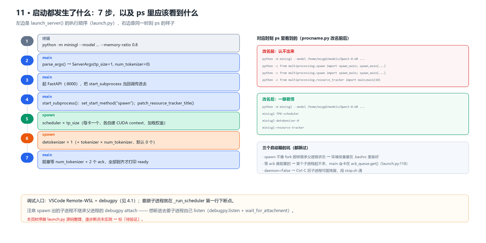
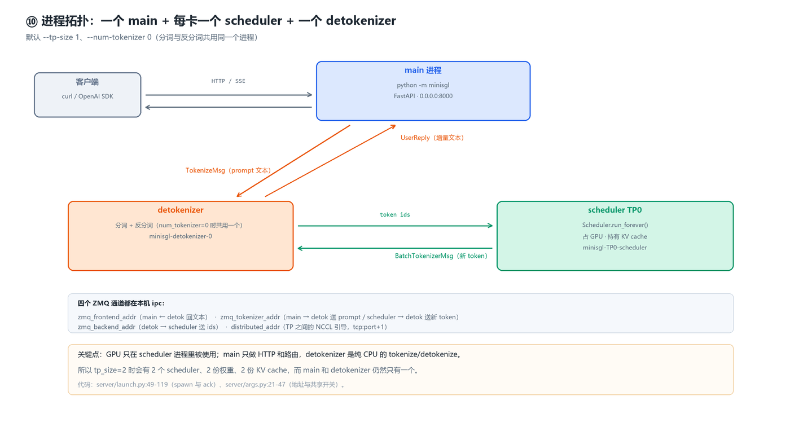

# sglang 调试：main 进程启动

> 本文是 mini-sglang / sglang 的**调试手记**，主线是「main 进程启动」。
>
> **本文档内容全部来自实际调试**：后续每次拿到新信息都会补进来，
> 统一整理成可复用的结论，并记录来源与验证方式。
> 未经验证的猜测标「待验证」，验证通过后才升级为「已确认」。

- 创建时间：2026-10-23
- 对应代码基线：`sgl-project/mini-sglang` @ `9a91cfa`
- 环境：WSL2 Ubuntu 24.04.5 / RTX 3070 8GB / CUDA 12.8 / Python 3.12
- 配套文档：《01-环境配置与运行指南》《02-模型目录实战》《踩坑记录》

---

## 记录约定

- 每条信息标注**来源**（哪次运行、哪条命令、哪段日志）
- 能定位到源码的补 `文件:行号`

---

## 0. TL;DR

- 调试入口：VSCode + debugpy 远程调试（WSL），见 4.1
- 从 `python -m minisgl` 到能接请求只有 **7 步**，见 [1](#1-启动链路)
- 进程只有三种角色（main / scheduler / detokenizer），GPU 只在 scheduler 里用，见 [2](#2-进程树与角色分工)
- 启动后打印的关键模型参数，见 3.1

## 1. 启动链路

`python -m minisgl` 到「可以接请求」一共 7 步（`server/launch.py:42-121`）：

| # | 谁 | 干什么 |
|---|---|---|
| 1 | 终端 | `python -m minisgl --model ... --memory-ratio 0.8` |
| 2 | main | `parse_args()` → `ServerArgs`（`tp_size`、`num_tokenizer`、端口） |
| 3 | main | 起 FastAPI（`0.0.0.0:8000`），把 `start_subprocess` 作为回调传进去 |
| 4 | main | `start_subprocess()`：`mp.set_start_method("spawn")` + `patch_resource_tracker_title()` |
| 5 | spawn | scheduler × `tp_size`（每卡一个，各自建 CUDA context、加载权重） |
| 6 | spawn | detokenizer × 1（`--num-tokenizer N` 时再加 N 个 tokenizer） |
| 7 | main | **阻塞**等 `num_tokenizer + 2` 个 ack，全到齐才打印 ready |



*图 1 · 启动 7 步，以及每一步对应时刻 `ps` 里应该看到什么（`procname.py` 改名前后）。*

> ⚠️ 这张时序是照 `launch.py` 源码整理的，**没有逐步下断点实测**，标「待验证」。
> 已经实测过的是**进程名**本身（`ps` 输出见《踩坑记录》§2）。

两个容易踩的点：

- **spawn 不继承父进程状态** —— 环境变量必须在 `~/.bashrc` 里备好（见《01》5.4），
  因为子进程是 exec 出来的新解释器，父进程 export 的东西传不过去。
- **等 ack 是阻塞的** —— 某个子进程起不来时，main 会卡在 `ack_queue.get()`
  （`launch.py:118`）而**不出任何日志**，看起来像「启动卡住」。

## 2. 进程树与角色分工



*图 2 · 拓扑：一个 main 管 HTTP，每卡一个 scheduler 吃 GPU，一个 detokenizer 管分词。*

默认参数（`--tp-size 1`、`--num-tokenizer 0`）下是这样的：

| 进程 | 数量 | 干什么 | `ps` 里的名字 | 占 GPU |
|---|---|---|---|---|
| main | 1 | FastAPI、路由、SSE | `python -m minisgl ...` | 否 |
| scheduler | `tp_size` | `Scheduler.run_forever()`，**唯一的 GPU 使用者** | `minisgl-TP{i}-scheduler` | **是** |
| detokenizer | 1 | 分词 + 反分词（`num_tokenizer=0` 时共用） | `minisgl-detokenizer-0` | 否 |
| tokenizer | `--num-tokenizer N` | 可选，独立分词进程 | `minisgl-tokenizer-{i}` | 否 |
| resource_tracker | 1 | `multiprocessing` 内部进程 | `minisgl-resource-tracker` | 否 |

四条 ZMQ 通道（都在本机 `ipc:///tmp/minisgl_*`，`args.py:26-51`）：

- `zmq_frontend_addr`：detok → main（回增量文本）
- `zmq_tokenizer_addr`：main → detok（送 prompt）；scheduler → detok（送新 token）
- `zmq_backend_addr`：detok → scheduler（送 token ids）
- `distributed_addr`：TP rank 之间的 NCCL 引导（`tcp://127.0.0.1:<port+1>`）

> 由此可以推出一个常被问的问题：**`--tp-size 2` 会多一倍显存吗？**
> 会 —— 因为 scheduler 是**每卡一个进程**，每个进程各自持有一份模型分片和一份 KV cache；
> 但 main 和 detokenizer 仍然只有一个。


## 3. 日志解读

### 3.1 启动后的关键模型参数信息

启动后打印：

```
ModelConfig(num_layers=28, num_qo_heads=16, num_kv_heads=8, head_dim=128, hidden_size=1024, vocab_size=151936, intermediate_size=3072, rms_norm_eps=1e-06, rotary_config=RotaryConfig(head_dim=128, rotary_dim=128, max_position=40960, base=1000000, scaling=None), hidden_act='silu', tie_word_embeddings=True, num_experts=0, num_experts_per_tok=0, moe_intermediate_size=0, norm_topk_prob=False, model_type='qwen3', architectures=['Qwen3ForCausalLM'])
```

拆开看（mini-sglang 自己的 `ModelConfig`，`models/config.py:17`）：

| 字段 | 值 | 中文注释 |
|---|---|---|
| num_layers | 28 | decoder 层数，模型堆了多少层 |
| num_qo_heads | 16 | Query / Output 的注意力头数 |
| num_kv_heads | 8 | Key / Value 的头数（GQA 的 KV 组数） |
| head_dim | 128 | 每个注意力头的维度 |
| hidden_size | 1024 | 隐藏层宽度，模型内部维度 |
| vocab_size | 151936 | 词表大小 |
| intermediate_size | 3072 | MLP 中间层宽度（FFN 维度） |
| rms_norm_eps | 1e-06 | RMSNorm 分母上加的 epsilon，防除零 |
| hidden_act | silu | 激活函数，SwiGLU 用的是 SiLU |
| tie_word_embeddings | True | 输入 embedding 与输出 lm_head 共享同一份权重 |
| num_experts | 0 | MoE 专家数，0 表示不是 MoE（稠密模型） |
| num_experts_per_tok | 0 | 每个 token 路由到几个专家 |
| moe_intermediate_size | 0 | MoE 专家各自的中间层宽度 |
| norm_topk_prob | False | 是否对 top-k 专家的路由概率做归一化 |
| model_type | qwen3 | 模型类型 |
| architectures | ['Qwen3ForCausalLM'] | 模型架构类名，决定加载哪套实现 |
| rotary_config.head_dim | 128 | RoPE 作用到的 head 维度 |
| rotary_config.rotary_dim | 128 | 实际做旋转的维度 |
| rotary_config.max_position | 40960 | 标称最大位置，即上下文长度 |
| rotary_config.base | 1000000 | RoPE 的 base（θ） |
| rotary_config.scaling | None | RoPE 频率缩放策略，None 表示不缩放 |

## 4. 调试手法

### 4.1 VSCode 远程调试（WSL）

用 VSCode（Remote - WSL）+ Python 扩展的 debugpy 调试，`.vscode/launch.json`：

```json
{
    "version": "0.2.0",
    "configurations": [
        {
            "name": "Python Debugger: sglang",
            "type": "debugpy",
            "request": "launch",
            "module": "minisgl",
            "args": [
                "--model","/home/mzygd/models/Qwen3-0.6B",
                "--memory-ratio","0.5",
                "--host","0.0.0.0",
                "--port","8000"
            ]
        },
        {
            "name": "Python Debugger: Attach using Process Id",
            "type": "debugpy",
            "request": "attach",
            "processId": "${command:pickProcess}"
        }
    ]
}
```
