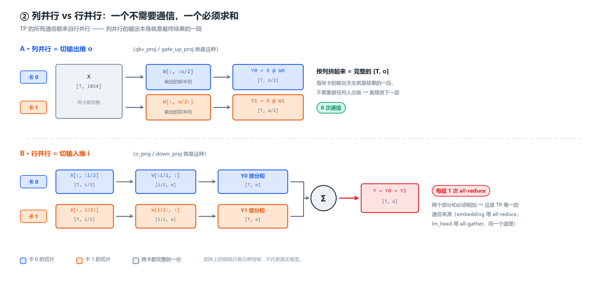
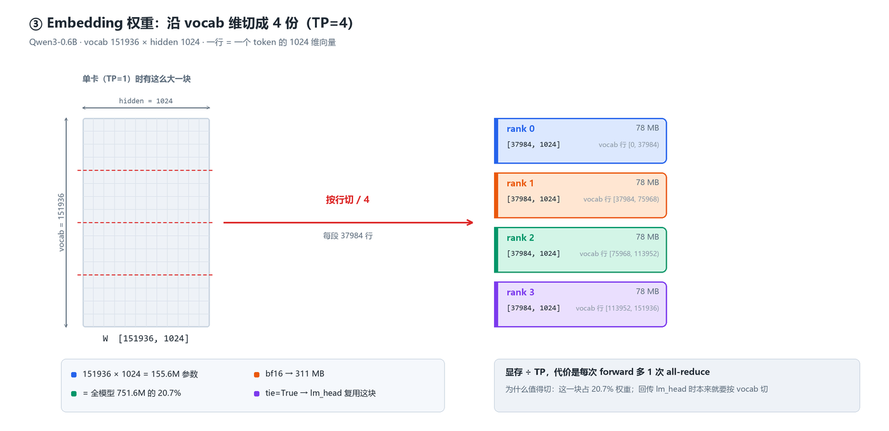
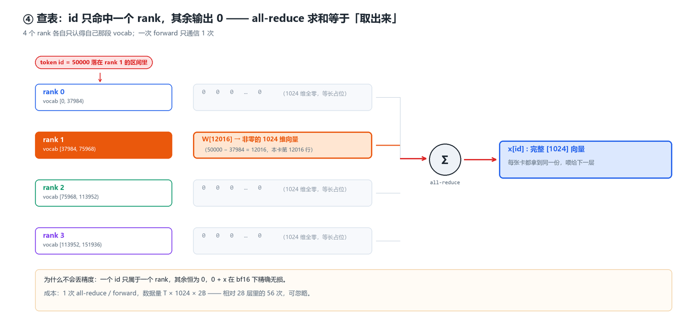
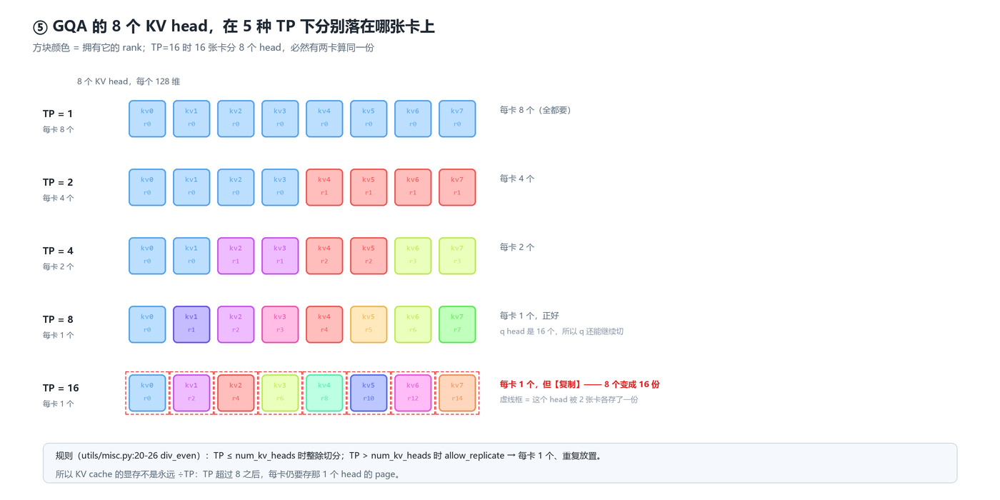
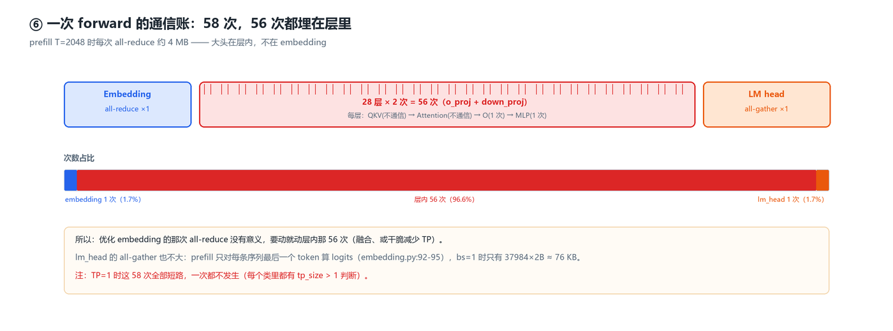
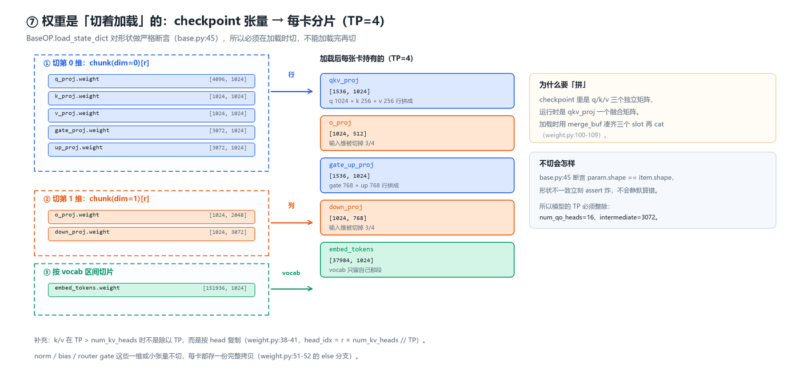

# 张量并行（TP）是怎么切的：embedding / attention / MLP 三种切分与通信

> 以 `~/workspace/mini-sglang`（`9a91cfa` + 本地改动）为准，**逐行对照源码**写成。
> 本文回答三个问题：**切哪个维度、为什么要切、切完要多付几次通信。**

- 创建时间：2026-10-24
- 代码基线：`sgl-project/mini-sglang` @ `9a91cfa`（本地未提交改动：`launch.py` / `tokenizer/server.py` / `utils/__init__.py` / `pyproject.toml`，新增 `procname.py`、`start.sh`、`stop.sh`、`pull-model.sh`）
- 核验方式：2026-10-24 从 WSL 复制 `python/minisgl` 到本地逐行阅读，**文中行号均为该副本实际行号**
- 环境：RTX 3070 8GB × **1 张** → 本机 `TP=1`，**TP>1 的路径未实测**，本文结论标注来源区分

---

## 0. TL;DR

**TP 只切三个维度，一个都不多切：**

| 模块 | 切哪个维度 | 每卡持有 | 通信 | 源码 |
|---|---|---|---|---|
| Embedding | **vocab** | `[vocab/TP, hidden]` | **1 次 all-reduce** | `layers/embedding.py:25-42` |
| QKV 投影 | **head**（输出维） | 本卡的 `q/kv` heads | 无 | `layers/linear.py:71-88` |
| Attention | head 维自动局部 | 本卡 heads 的 KV cache | 无 | `layers/attention.py:32-57` |
| O 投影 | **输入维**（行并行） | `[hidden, hidden/TP]` | **1 次 all-reduce** | `layers/linear.py:91-106` |
| MLP gate/up | **intermediate**（输出维） | `[hidden, 2×inter/TP]` | 无 | `layers/linear.py:56-68` |
| MLP down | **输入维**（行并行） | `[inter/TP, hidden]` | **1 次 all-reduce** | `layers/linear.py:109-127` |
| LM head | **vocab** | `[vocab/TP, hidden]` | **1 次 all-gather** | `layers/embedding.py:88-110` |

**单次 forward 的通信账（Qwen3 28 层）**：

```
1 (embedding all-reduce) + 28 × 2 (每层 o_proj + down_proj) + 1 (lm_head all-gather) = 58 次
```

数据量每次都是 `num_tokens × hidden × 2B`。注意 **58 次里只有 1 次来自 embedding** ——
剩下 56 次全在层内，所以那次 all-reduce 根本不值得优化。

**核心规则一句话**：*列并行切输出、行并行切输入，成对出现，只在这一对的末尾 reduce 一次。*


*图 1 · 先看全景：Qwen3-0.6B 在 TP=4 下，单张卡的完整链路。蓝框 = 切 vocab / head 的层，橙框 = 切输入维（因此要 all-reduce）的层，右侧红色标签 = 这一次 forward 的全部集合通信。*

---

## 1. 为什么要切，以及能切哪三个维度

单卡 8 GB 放不下大模型只是表面原因，真正的理由是**切分维度必须落在"不破坏算子语义"的位置**。模型里能安全切的只有三处：

| 维度 | 语义 | 谁在用 | 切了会不会串味 |
|---|---|---|---|
| vocab | 词表行 | embedding / lm_head | 不会，每个 token 只属于一行 |
| head | 注意力头 | qkv / o_proj / KV cache | 不会，头之间天然独立 |
| intermediate | FFN 中间维 | gate/up/down | 不会，神经元之间无交互 |

**hidden 维不切**（注意力、layer norm 都要看完整向量），**层维不切**（那是 PP，不是 TP）。

### 1.1 列并行 + 行并行：只通信一次的秘诀

一个 `Y = XW`（`X:[T, i]`，`W:[i, o]`）：

- **列并行**（切 `o`）：每卡算 `Y_r = X @ W[:, o_r]`，输出是**列块**。`X` 必须完整 → 无通信。
- **行并行**（切 `i`）：每卡算 `Y_r = X[:, i_r] @ W[i_r, :]`，输出是**部分和**。需要 `Σ Y_r` → **一次 all-reduce**。

关键在于配对：`qkv_proj`（列并行，输出 head 块）紧接 `o_proj`（行并行，输入 head 块），
中间那个 `Y` 从头到尾没被拼起来过 —— **整条 attention 只有一个 reduce**。
MLP 同理：`gate_up`（列并行）→ 激活 → `down`（行并行），**也只有一个 reduce**。

> 如果反过来（先切输入再切输出），每层就得多付一次 all-gather，等于通信量翻倍。



*图 2 · 上半：列并行，两张卡各算一段输出列，拼起来就是完整结果，**全程零通信**；下半：行并行，两张卡各算一份部分和，必须 all-reduce 相加。*

---

## 2. Embedding：切 vocab

### 2.1 代码

```python
# python/minisgl/layers/embedding.py:21-30
tp_info = get_tp_info()
tp_rank = tp_info.rank
self.tp_size = tp_info.size
self.num_embeddings_tp = div_ceil(num_embeddings, self.tp_size)   # 151936/TP，向上取整
start_idx  = self.num_embeddings_tp * tp_rank
finish_idx = min(start_idx + self.num_embeddings_tp, num_embeddings)
self.vocab_range = (start_idx, finish_idx - start_idx)            # (起点, 本卡行数)
self.weight = torch.empty(self.num_embeddings_tp, embedding_dim)  # 只存自己那段
```

```python
# python/minisgl/layers/embedding.py:33-42
y = indexing(
    weights=self.weight,
    indices=x,
    vocab_range=self.vocab_range if self.tp_size > 1 else None,
)
return self._comm.all_reduce(y) if self.tp_size > 1 else y
```

`vocab_range` 被直接塞进 kernel（`kernel/index.py:31-50`），由 CUDA kernel 在查表时做「越界置 0」，
比 vLLM/SGLang 的 `masked_input + masked_fill_` 少两次 elementwise pass（实测性能没测过，**从代码形态推断**）。



*图 3 · 一块 `[151936, 1024]` 的权重沿 vocab 维切成 4 份，每卡只留自己那 37984 行（78 MB）。注意切的是**行**，hidden 维完整保留。*

### 2.2 那个 all-reduce 到底在干什么

查表 `y[i] = W[id_i]`，而 `W` 被按行切开了。于是对同一个 token id：

| rank 0 | rank 1 | … | all-reduce(SUM) |
|---|---|---|---|
| 命中 → 正确向量 | 未命中 → **全 0** | … | = 正确向量 |

**不是平均、不是拼接，是「求和把唯一非零的那份挑出来」。** 因为一个 id 只可能落在一个 rank 的区间内，
`0 + x` 在浮点下精确无损（vLLM 甚至据此对 FP8 直接做 `int8` SUM）。



*图 4 · token id=50000 只落在 rank 1 的 `[37984, 75968)` 区间里，另外三张卡算出来是 1024 维全零；Σ 一加，就等于把那份向量「取」了出来。*

### 2.3 为什么值得切（用你自己的模型算）

Qwen3-0.6B：`vocab=151936`，`hidden=1024`

- embedding 参数 = 151936 × 1024 = **155.6M**，占全模型 751.6M 的 **20.7%**
- `tie_word_embeddings=True` → **lm_head 就是同一块内存**，一份权重干两件事
- TP=2 时每卡少 77.8M 参数 ≈ **156 MB**（bf16）—— 8 GB 卡上这是实打实的 KV cache 空间

### 2.4 LM head：切完要 all-gather

```python
# python/minisgl/layers/embedding.py:88-110（节选）
if batch.is_prefill:
    indices = batch.attn_metadata.get_last_indices(bs)   # 只保留每条序列最后一个 token
    x = x[indices].contiguous()
module = self.tied_embedding or self                     # tie 时直接用 embedding 的权重
logits = F.linear(x, module.weight, self.bias)
if self.tp_size == 1:
    return logits
output_tensor = self._comm.all_gather(logits)            # 拼回 [T, vocab/TP*TP]
...
return output_tensor[:, : self.num_embeddings]           # 截掉 padding
```

两个细节值得记：

1. **prefill 阶段只算最后一个 token 的 logits**（`get_last_indices`）—— 省掉 `T×vocab` 里绝大部分计算；
2. tie 的实现方式是 `tied_embedding` 引用同一段权重（`embedding.py:45-75`），加载时把 checkpoint 里的
   `lm_head.weight` **从 state_dict 里 pop 掉**，见 `qwen3.py:69-74`。

> 呼应《02》第 2 讲：这就是为什么 `config.json` 里 `tie_word_embeddings: true` 会影响显存 —— 它直接决定
> 你是存 155.6M 参数，还是 311.2M。

---

## 3. Attention：切 head

### 3.1 QKV 是一个 fused 列并行层

```python
# python/minisgl/layers/linear.py:71-88
local_num_qo = div_even(num_qo_heads, tp_info.size)                          # 16/TP
local_num_kv = div_even(num_kv_heads, tp_info.size, allow_replicate=True)    # 8/TP，可能复制
full_isize  = hidden_size
full_osize  = (num_qo_heads + 2 * num_kv_heads) * head_dim                   # 32×128 = 4096
local_osize = (local_num_qo + 2 * local_num_kv) * head_dim                   # 本卡输出列数
```

注意它**不是**切的「q/k/v 三个矩阵」，而是切 fused 之后的那个大矩阵的**行**（即输出维），
`q/k/v` 各自取自己的 head 段。加载时靠 `weight.py` 把 checkpoint 里分开的 `q_proj/k_proj/v_proj`
拼成 `qkv_proj`（`models/weight.py:13-30, 100-109`）。

### 3.2 GQA 的坑：KV head 可能比卡数还少

`div_even(..., allow_replicate=True)`（`utils/misc.py:20-26`）：当 `TP > num_kv_heads` 时返回 **1**，
即**每张卡都放 1 个 KV head（复制，不切）**。加载侧对应地在 `weight.py:38-41` 用
`head_idx = r * num_kv_heads // n` 取重复的 head。

Qwen3-0.6B 的 `num_qo_heads=16, num_kv_heads=8, head_dim=128`：

| TP | qo heads/卡 | kv heads/卡 | qkv 输出列/卡 | o_proj 输入列/卡 |
|---|---|---|---|---|
| 1 | 16 | 8 | 4096 | 2048 |
| 2 | 8 | 4 | 2048 | 1024 |
| 4 | 4 | 2 | 1024 | 512 |
| 8 | 2 | 1 | 512 | 256 |
| 16 | 1 | 1（**复制**，只有 8 个真 head） | 384 | 128 |

TP=16 时 16 张卡抢 8 个 KV head，必然有卡在算重复的 KV —— 这是 GQA + 大 TP 的固有浪费，值得记住。



*图 5 · 8 个 KV head 在 5 种 TP 下的归属。TP≤8 时每个 head 归一张卡；TP=16 时 head 不够分，`allow_replicate` 让两张卡各存一份（虚线框），算力白费一半。*

### 3.3 Attention 本体不通信

`attention.py:32-36` 用同样的 `div_even` 算出本卡 head 数，`forward` 里只处理本卡的
`q/k/v` 切片，然后交给 `ctx.attn_backend.forward(...)`（`attention.py:56`）—— 后端看到的就是**局部 heads**，
因此 **KV cache 也自然是按卡分片的**（每卡只为自己那几个 head 分配 page），显存随 TP 线性下降。

### 3.4 O 投影：行并行，一次 reduce

```python
# python/minisgl/layers/linear.py:91-106
local_isize = div_even(input_size, tp_info.size)   # 输入 = head_dim*qo_heads，切
local_osize = output_size                          # 输出 = hidden，完整
...
def forward(self, x):
    y = F.linear(x, self.weight, self.bias)
    if self._tp_size > 1:
        y = self._comm.all_reduce(y)               # ← 每层唯一/之一的那次通信
    return y
```

---

## 4. MLP：切 intermediate

```python
# python/minisgl/layers/linear.py:56-68  LinearColParallelMerged
tp_output_sizes = [div_even(size, tp_info.size) for size in output_sizes]  # [inter, inter] 各自切
tp_output_size  = sum(tp_output_sizes)                                     # 2*inter/TP
```

```python
# python/minisgl/models/utils.py:27-42
self.gate_up_proj = LinearColParallelMerged(
    config.hidden_size, [config.intermediate_size, config.intermediate_size], has_bias=False)
...
self.down_proj = LinearRowParallel(
    config.intermediate_size, config.hidden_size, has_bias=False)
```

所以 MLP 的完整链路是：

```
x[hidden] --列并行--> gate_up[T, 2*inter/TP] --silu_and_mul--> [T, inter/TP] --行并行+all_reduce--> [hidden]
```

Qwen3-0.6B：`intermediate=3072`，TP=2 时每卡 `[1024, 1536]`（gate/up 各 1536 列），down 为 `[1536, 1024]`。

---

## 5. 全链路通信账本

以一次 prefill（`T` 个 token，`hidden=1024`，bf16）为例：

| 步骤 | 集合通信 | 次数 | 单次数据量 |
|---|---|---|---|
| embedding | all-reduce | 1 | `T × 1024 × 2B` |
| 每层 o_proj | all-reduce | 28 | 同上 |
| 每层 down_proj | all-reduce | 28 | 同上 |
| lm_head | all-gather | 1 | `bs × 151936/TP × 2B`（**只算最后一个 token**） |

`T=2048` 时单次约 **4 MB**，一次 forward 合计约 `57 × 4 MB ≈ 228 MB` 的 all-reduce 流量 ——
在 NVLink 上是微秒级，在 PCIe 上就是毫秒级，**这就是 3070 这种消费卡上 TP 收效不明显的原因之一**。



*图 6 · 58 次通信的构成：层内 56 次占了 96.6%，embedding 和 lm_head 各 1 次。所以「优化 embedding 的 all-reduce」几乎不会有收益。*

通信实现有两条路（`distributed/impl.py`）：

- `TorchDistributedImpl`（默认）：`dist.all_reduce` / `dist.all_gather_into_tensor`（`:24-41`）
- `PyNCCLDistributedImpl`：`kernel/pynccl.py` 里的自建 NCCL 通信器，启动时 `enable_pynccl_distributed()` 追加（`:73-90`）

> 另有一次**不属于** per-forward 账本的通信：启动时用 `MIN` all-reduce 对齐各卡空闲显存，
> 差超过 2 GB 直接报错（`engine/engine.py:170-187`）。这是为了算 KV cache 时各卡口径一致。

### 5.1 TP 是怎么启动起来的

`--tensor-parallel-size N`（`server/args.py:86-92`）不是"一个进程里开 N 个流"，而是**真的起 N 个进程**：

```python
# python/minisgl/server/launch.py:60-68
world_size = server_args.tp_info.size
for i in range(world_size):
    ... tp_info=DistributedInfo(i, world_size) ...
```

每个 scheduler 进程在自己的 `Engine.__init__` 里 `set_tp_info(rank, size)`（`engine/engine.py:32`）——
这和《踩坑记录》§2 里那些 `multiprocessing.spawn` 子进程是同一批东西。

---

## 6. 权重是怎么"切着加载"的（不切就会 assert 挂）

`BaseOP.load_state_dict` 对每个张量做**严格形状断言**：

```python
# python/minisgl/layers/base.py:42-46
if isinstance(param, torch.Tensor):
    item = state_dict.pop(_concat_prefix(prefix, name))
    assert param.shape == item.shape and param.dtype == item.dtype
```

所以切分**必须发生在加载阶段**，由 `models/weight.py:34-52` 的 `_shard_tensor` 完成：

| checkpoint 里的 key | 切法 | 代码 |
|---|---|---|
| `q_proj/k_proj/v_proj/gate_proj/up_proj` | `chunk(dim=0)[r]` 切输出维 | `:36-42` |
| `k_proj/v_proj` 且 `num_kv_heads < TP` | 按 head 复制（`head_idx = r*num_kv_heads//TP`） | `:38-41` |
| `o_proj/down_proj` | `chunk(dim=1)[r]` 切输入维 | `:43-44` |
| `embed_tokens/lm_head` | 按 vocab 区间切片 | `:45-50` |
| 其它（norm、bias、router gate） | **不切，每卡复制** | `:51-52` |

同时它负责两件"形状重排"：`q/k/v → qkv_proj`、`gate/up → gate_up_proj` 的 **merge**（`:100-109`），
以及 MoE 专家按 `num_experts` 堆叠（`:111-119`）。



*图 7 · checkpoint 里的七种张量按三种规则切（第 0 维 / 第 1 维 / vocab 区间），落到每卡之后变成 5 个融合张量；q/k/v 与 gate/up 还要在内存里拼起来。*

> 一个推论：**TP 必须整除 `num_qo_heads` 和 `intermediate_size`**，否则 `div_even` 直接 assert 失败
> （`utils/misc.py:25`）。Qwen3-0.6B 支持到 TP=16（qo=16），TP=32 起就切不动了。

---

## 7. 什么时候 TP 是白花钱

- **`TP=1` 时全部退化**：上面每个类里都有 `if tp_size > 1` 或 `if self._tp_size > 1` 的短路，
  通信一次都不会发生（`embedding.py:42`、`linear.py:104/126`、`distributed/impl.py:28-29`）。
  **你本机就是这个状态**：`--tp-size` 默认 1（`args.py:86-92`），而 `start.sh` 里也没传，所以跑的是最朴素的单卡路径。
- **小 batch decode**：`T` 只有 `bs`（几个 token），all-reduce 的数据量很小，但**延迟是固定的**
  —— 通信占比反而最高，TP=2 常常比 TP=1 慢。
- **显存没爆就别急着开 TP**：TP 的收益是「允许更大的模型」，不是「更快」。

> ⚠️ **待验证**：本机只有一张 3070，以上关于 TP>1 的性能判断来自源码与常识，**未实测**。
> 想验证「切分是否正确」，最省钱的办法是单卡跑一遍，再找台多卡机器跑 `TP=2` 比 greedy 输出是否逐 token 一致。

---

## 8. 和 vLLM / 官方 SGLang 的对应关系

| 概念 | mini-sglang | vLLM | SGLang |
|---|---|---|---|
| vocab 切分 | `VocabParallelEmbedding` | 同名 | 同名（vLLM 移植） |
| LM head | `ParallelLMHead`（tie 时复用 embedding 权重） | `ParallelLMHead`（权重交给 sampler） | 同 vLLM |
| 列并行 | `LinearColParallelMerged` / `LinearQKVMerged` | `ColumnParallelLinear` / `QKVParallelLinear` | 同 vLLM |
| 行并行 | `LinearOProj` / `LinearRowParallel` | `RowParallelLinear` | 同 vLLM |
| 复制层 | `LinearReplicated`（MoE router gate，`models/utils.py:62-66`） | `ReplicatedLinear` | 有 |
| 通信实现 | torch.distributed 或自建 PyNCCL | 自定义 `GroupCoordinator` | 同 vLLM |

**设计完全一致**（都是 Megatron-LM 那套列/行并行 + vocab 并行），差异只在工程细节：
vLLM/SGLang 把 mask+查表融合进 CUDA kernel 并支持量化权重、`reduce_results=False` 跳过 reduce；
mini-sglang 保留最直白的形态 —— **这也正是它适合当教材的原因**。

---

## 9. 动手验证清单

在 WSL 里（`cd ~/workspace/mini-sglang`）：

```bash
# 1) 看每卡权重形状：TP=1 时应等于完整形状
python - <<'PY'
from minisgl.distributed import get_tp_info
print(get_tp_info())
PY

# 2) 看 embedding 到底切了多少
grep -n "num_embeddings_tp\|vocab_range" -r python/minisgl/layers/embedding.py

# 3) 数一数一层里到底有几次 all_reduce
grep -n "all_reduce" -r python/minisgl/layers/ python/minisgl/models/
```

预期：`layers/linear.py` 里只有两处（`LinearOProj`、`LinearRowParallel`），
`layers/embedding.py` 一处，`layers/moe.py` 一处 —— 与 §5 的账本一致。

---

## 相关文档

- 《01-WSL-Ubuntu24.04-mini-sglang-环境配置与运行指南》—— 环境与启动
- 《02-手把手带你读懂一个模型目录-Qwen3-0.6B实战》—— `config.json` 里本文用到的那些数字从哪来
- 《03sglang调试main进程启动》—— `ModelConfig` 字段解释
- 《踩坑记录》—— 跑起来才会遇到的坑
