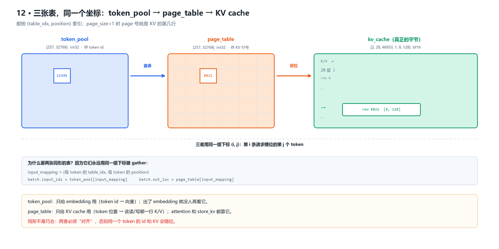
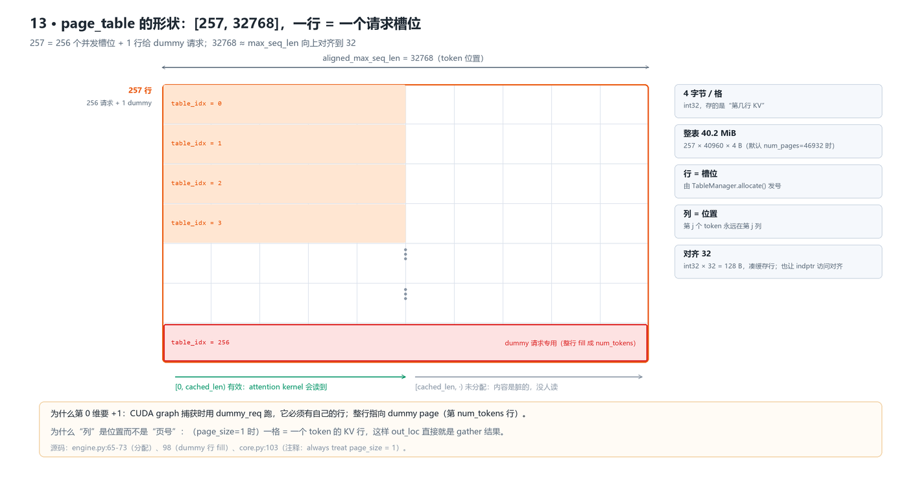
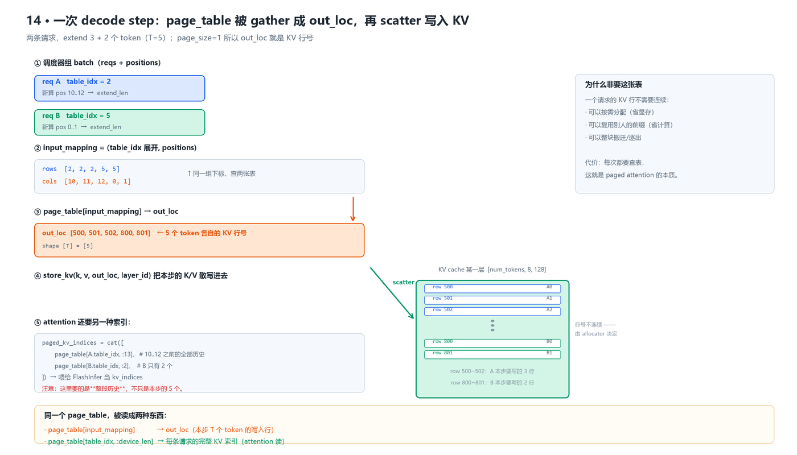
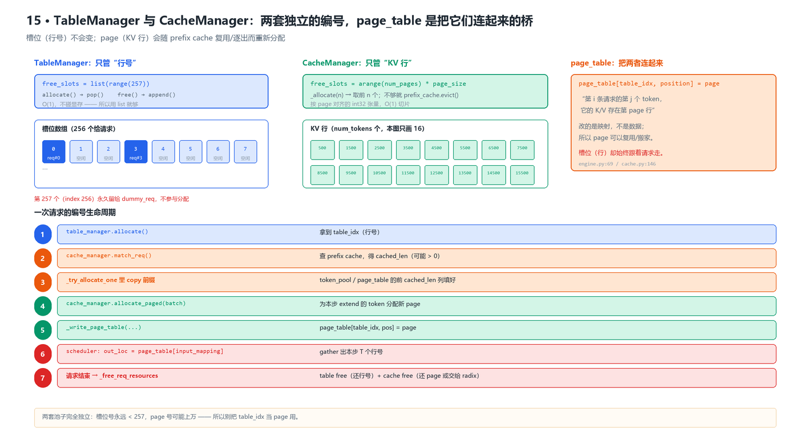

# page_table 与 TableManager：逐行源码解析

> 这篇只讲一件事：**token 的位置 → KV cache 的哪一行** 这个映射是怎么建、怎么读、怎么改、怎么回收的。
> 全部按 `~/workspace/mini-sglang`（`9a91cfa`）逐行核对，行号就是实际行号。

- 创建时间：2026-10-24
- 代码基线：`sgl-project/mini-sglang` @ `9a91cfa`
- 涉及文件：`engine/engine.py`、`core.py`、`scheduler/table.py`、`scheduler/cache.py`、`scheduler/prefill.py`、`scheduler/scheduler.py`、`kvcache/mha_pool.py`、`attention/fi.py`
- 前置：先看《04》搞清 TP 怎么切，再看这篇更顺

---

## 0. TL;DR

1. **`page_table` 是一张 `[257, 32768]` 的 int32 表**，语义是「第 `i` 个请求槽位的第 `j` 个 token，它的 K/V 存在第几行」。
2. **`TableManager` 只有 21 行**，它只管「发号」——从 0~255 里挑一个空闲的**行号**给你，跟 KV 显存毫无关系。
3. **真正的 KV 分配在 `CacheManager`**，它从 `free_slots` 里切一段 page 出来，然后**写进 `page_table` 那一行**。
   所以：`page_table` 是「槽位编号」和「KV 行号」之间的**唯一桥梁**。



*图 1 · 三张表共享同一个 `(table_idx, position)` 坐标：token_pool 存 token id，page_table 存 KV 行号，kv_cache 存真正的字节。*

---

## 1. 先把三个矩阵的形状钉死

以默认参数（`--num-pages 46932`、`page_size=1`、`max_running_req=256`、`max_seq_len=40960`）为例：

| 名字 | 形状 | dtype | 大小 | 存什么 | 谁读它 |
|---|---|---|---|---|---|
| `page_table` | `[257, 40960]` | int32 | **40.2 MiB** | token 位置 → **KV 行号** | `store_kv`、attention、prefix cache |
| `token_pool` | `[257, 40960]` | int32 | **40.2 MiB** | token 位置 → **token id** | 只给 embedding 用 |
| `kv_cache` | `[2, 28, 46933, 1, 8, 128]` | bf16 | **5.01 GiB** | 真正的 K / V 字节 | attention kernel |
| `TableManager.free_slots` | `list[int]`，≤ 257 | Python int | ~2 KB | 空闲的**行号** | `allocate()` |
| `CacheManager.free_slots` | `[46932]` | int32 | ~183 KiB | 空闲的 **page（= token 行）** | `_allocate()` |

维度含义：`257 = 256 槽位 + 1 dummy`、`40960 = min(max_seq_len, num_tokens) 向上对齐 32`、
`46933 = num_pages + 1（dummy page）`、`2 = K/V`、`28 = 层数`、`1 = page_size`、`8/128 = kv head 数 / head_dim`。

> 注意 **`page_table` 和 `token_pool` 各占 40.2 MiB**，加起来 80 MiB。《01》里那张显存表只算了 `page_table`，
> 严格说要算两份。这也是为什么 `--num-pages` 调小能省一点：`aligned_max_seq_len` 会跟着 `num_tokens` 一起变小。

---

## 2. 创建：`engine.py:65-73` 逐行

```python
# engine.py:65-73
# ======================= Page table initialization ========================
# NOTE: 1. aligned to 128 bytes; 2. store raw locations instead of pages
self.max_seq_len = min(config.max_seq_len, num_tokens)
aligned_max_seq_len = _align_up_32(self.max_seq_len)
self.ctx.page_table = self.page_table = torch.zeros(  # + 1 for dummy request
    (config.max_running_req + 1, aligned_max_seq_len),
    dtype=torch.int32,
    device=self.device,
)
```

逐行拆：

| 行 | 代码 | 为什么 |
|---|---|---|
| 66 | 注释 ①「aligned to 128 bytes」 | int32 × 32 = 128 B，正好一个 CPU cache line。`page_table` 会被 host 侧反复读（构造 `paged_kv_indices` 时 `torch.cat`），对齐能少一次跨行访问 |
| 66 | 注释 ②「store raw locations instead of pages」 | 表里存的是**行号**（= `page × page_size + offset`），不是页号。因为 flashinfer 要求 `page_size == 1`，页号就是行号；若哪天 `page_size > 1`，这里也不用改语义 —— 见 `core.py:103` 的注释 `# NOTE: this table always treat page_size = 1` |
| 67 | `min(config.max_seq_len, num_tokens)` | 一张表最多能索引到「池子里一共有多少 token」。`num_tokens` 比 `max_seq_len` 小时，多余列没意义 |
| 68 | `_align_up_32(...)` | 向上取整到 32 的倍数（`engine.py:214-215` 的 `(num + 31) // 32 * 32`） |
| 70 | `max_running_req + 1` | **+1 是给 dummy 请求**（CUDA graph 捕获时用），见 §3 |
| 71 | `dtype=torch.int32` | 行号最大约 46932，int32 绰绰有余（int16 就不够了） |
| 69 | `self.ctx.page_table = self.page_table = ...` | 同一个张量同时挂在 `Context`（给 kernel 层用）和 `Engine`（给调度层用）上，**是同一个对象**，没有拷贝 |

## 3. `TableManager`：21 行，逐行

```python
# scheduler/table.py 全文
class TableManager:
    def __init__(self, max_running_reqs: int, page_table: torch.Tensor) -> None:
        self._max_running_reqs = max_running_reqs
        self._free_slots = list(range(max_running_reqs))
        self.page_table = page_table
        # NOTE: dummy request also use this pool to get the input ids, so we need to
        # make sure the token pool is initialized with valid values (token_id = 0).
        self.token_pool = torch.zeros_like(page_table, dtype=torch.int32)

    @property
    def available_size(self) -> int:
        return len(self._free_slots)

    def allocate(self) -> int:
        return self._free_slots.pop()

    def free(self, slot: int) -> None:
        self._free_slots.append(slot)
```

| 行 | 说明 |
|---|---|
| 6 | `list(range(256))` —— **用 Python list 而不是张量**。理由：总共才 257 个元素，`pop()/append()` 是 O(1) 且完全不碰 GPU；用张量反而要 `torch.cat`/切片，还得处理异步 |
| 8 | `page_table` 是**引用**，不是拷贝。TableManager 自己不分配 KV，只是拿着这张表 |
| 9-11 | `token_pool = zeros_like(page_table)` —— **和 page_table 同形状**。注释解释了「必须初始化为合法值（0）」：dummy 请求也会来 `token_pool` 取 input_ids，取到未初始化内存会喂出随机 token |
| 18 | `allocate()` = 从尾部弹一个行号。**没有"最优匹配"、没有"回收再利用策略"** —— 因为它只是行号，谁用都一样 |
| 21 | `free()` = 还回去。所以行号是 **LIFO** 复用，刚释放的最可能被下一个请求拿到 |

**它不管的事**：不碰 KV cache、不碰 `page_table` 的内容、不管请求有多长。它就是一个「行号发号器 + token 池的宿主」。

> 一个容易误解的点：`TableManager.allocate()` 发的不是「第几个请求」，而是**第几行**。所以同一个请求在整个生命周期里 `table_idx` 不变，但同一行会被不同请求先后复用。

### dummy 请求为什么必须单独占一行

```python
# engine.py:88-98
self.dummy_req = Req(
    input_ids=torch.tensor([0], ...),
    table_idx=config.max_running_req,   # ← 最后一行，永远不给真实请求
    ...
)
self.page_table[self.dummy_req.table_idx].fill_(num_tokens)  # point to dummy page
```

因为 `page_table` 只有 `max_running_req + 1` 行，前 256 行分给真实请求；dummy 用第 257 行（index 256）。
整行 `fill_(num_tokens)` 指向 **dummy page** —— KV cache 申请时特意多要了一页（`engine.py:59` 的 `num_pages + 1`），
所以 dummy 写 KV 只会污染这一页，**不会踩到任何真实请求的数据**。



*图 2 · 行的两段，列的两段：前 256 行给请求、第 257 行给 dummy；每行前 `cached_len` 列有效，后面没人读。*

---

## 4. `page_table` 的四种读法

### 4.1 读法 A：`out_loc` —— 本步要写哪些行

```python
# scheduler/scheduler.py:204-211
def _prepare_batch(self, batch: Batch) -> ForwardInput:
    self.engine.graph_runner.pad_batch(batch)
    self.cache_manager.allocate_paged(batch.reqs)        # ① 先分配 page
    batch.positions = _make_positions(batch, self.device) # ② 位置
    input_mapping = _make_input_tuple(batch, self.device) # ③ (table_idx, position)
    write_mapping = _make_write_tuple(batch, self.device)
    batch.out_loc = self.engine.page_table[input_mapping] # ④ 查表
    self.engine.attn_backend.prepare_metadata(batch)
```

`input_mapping` 是两个等长的一维索引（`scheduler.py:252-259`）：

```python
mapping_host[offset : offset + length].fill_(req.table_idx)   # 行：本请求的槽位号
positions = torch.arange(req.cached_len, req.device_len)      # 列：本步要算的位置
```

所以 `page_table[input_mapping]` 就是「把这批请求本步所有 token 的 KV 行号拼成一个扁平向量」，长度 `T = Σ extend_len`。

用途：`store_kv` 用它做 scatter 写入（`mha_pool.py:45-56`）——
**为什么是 scatter 而不是 append？因为行号由 allocator 决定，可能完全不连续**。

### 4.2 读法 B：`paged_kv_indices` —— attention 要读哪些行

```python
# attention/fi.py:210-215
page_table = get_global_ctx().page_table
batch.attn_metadata = FIMetadata(
    ...
    indices=torch.cat([page_table[req.table_idx, : req.device_len] for req in reqs]),
    ...
)
```

注意和 A 的区别：

| | 取哪些列 | 长度 |
|---|---|---|
| A（`out_loc`） | `[cached_len, device_len)` —— **本步新算的** | `T` |
| B（`indices`） | `[0, device_len)` —— **该请求的全部历史** | `Σ device_len` |

同一个表，两种切片，喂给同一个 kernel 的两个参数（`qo_indptr` vs `paged_kv_indptr`）。
**这就是 paged attention 的全部秘密**：没有这张表，你就得让 KV 在显存里连续。



*图 3 · 一个 decode step：`page_table[input_mapping]` 取出 5 个行号（本步写），`page_table[idx, :device_len]` 取出整段历史（attention 读）。*

### 4.3 读法 C：`page_indices` —— 把前缀交给 radix cache

```python
# scheduler/cache.py:67-70
insert_ids = req.input_ids[: req.cached_len]
page_indices = self.page_table[req.table_idx, : req.cached_len]
cached_len, new_handle = self.prefix_cache.insert_prefix(insert_ids, page_indices)
```

radix cache 的节点里存的是 **token 序列 → 对应的 page 索引**（`radix_cache.py:142` 的 `set_key_value`）。
所以「命中的前缀」不只是记住了 token id，还记住了**这些 token 的 KV 在哪几行** —— 新请求可以直接 `copy_` 过来。

### 4.4 读法 D：`check_integrity` 里的守恒式

```python
# scheduler/cache.py:83-84
cache_pages = self.prefix_cache.size_info.total_size // self.page_size
if len(self.free_slots) + cache_pages != self.num_pages:
    raise RuntimeError("CacheManager integrity check failed: ...")
```

**空闲 + 缓存 = 总数**，一个 page 不能同时在两边。这条检查在 scheduler 空闲时跑（`run_when_idle`）。

---

## 5. `page_table` 的两种写法

### 5.1 写 A：`_write_page_table`（逐行）

```python
# scheduler/cache.py:127-146
def _write_page_table(page_table, allocated, allocation_info, page_size):
    needed_tokens = len(allocated)
    table_idx_host = torch.empty(needed_tokens, dtype=torch.int64, pin_memory=True)
    positions_host = torch.empty(needed_tokens, dtype=torch.int64, pin_memory=True)
    offset = 0
    for table_idx, first_page, last_page in allocation_info:
        first_pos, last_pos = first_page * page_size, last_page * page_size
        length = last_pos - first_pos
        table_idx_host[offset : offset + length].fill_(table_idx)
        torch.arange(first_pos, last_pos, out=positions_host[offset : offset + length])
        offset += length
    assert offset == needed_tokens, "Mismatch in allocated tokens and filled tokens."
    table_idxs = table_idx_host.to(page_table.device, non_blocking=True)
    offsets = positions_host.to(page_table.device, non_blocking=True)
    page_table[table_idxs, offsets] = allocated
```

| 行 | 在干什么 | 为什么这么写 |
|---|---|---|
| 134-135 | 先在 **CPU pinned 内存**上建两个索引数组 | 索引依赖 Python 循环，只能在 host 拼；pinned 才能 `non_blocking` 异步传 |
| 137-142 | 按请求顺序填 `(table_idx, position)` 对，**同时**把 `allocated` 里的 page 号按顺序排 | 三者顺序必须严格一致，否则 KV 会写错位置 |
| 143 | 断言「填的量 == 分配的量」 | 这类 bug 一旦发生是静默的数据损坏，所以宁可 assert |
| 144-145 | 异步 H2D 拷贝两个索引张量 | 和 GPU 端的其它工作重叠 |
| 146 | `page_table[table_idxs, offsets] = allocated` | **花式索引赋值** = 一次 scatter，把所有新 page 一次性写进表里 |

它的调用方：

```python
# scheduler/cache.py:42-53
def allocate_paged(self, reqs):
    needed_pages = 0
    allocation_info = []
    for req in reqs:
        first_page = div_ceil(req.cached_len, self.page_size)
        last_page = div_ceil(req.device_len, self.page_size)
        if last_page > first_page:                  # 本步需要新的 page
            needed_pages += last_page - first_page
            allocation_info.append((req.table_idx, first_page, last_page))
    if needed_pages > 0:
        allocated = self._page_to_token(self._allocate(needed_pages))
        _write_page_table(self.page_table, allocated, allocation_info, self.page_size)
```

注意 `_page_to_token`（`cache.py:119-124`）：`page_size=1` 时它是**恒等映射**，`page_size>1` 时才把页号展开成「页内每个 token 的行号」。
这就是「表里存 raw location 而不是 page」的落地。

### 5.2 写 B：前缀命中时直接 copy

```python
# scheduler/prefill.py:56-62
table_idx = self.table_manager.allocate()
if cached_len > 0:  # NOTE: set the cached part
    device_ids = self.table_manager.token_pool[table_idx][:cached_len]
    page_entry = self.table_manager.page_table[table_idx][:cached_len]
    device_ids.copy_(req.input_ids[:cached_len].pin_memory(), non_blocking=True)
    page_entry.copy_(handle.get_matched_indices())
```

**这两行是这个系统的精髓**：新请求命中了 1000 token 的前缀，就把那 1000 个 token id 和 1000 个 KV 行号
**直接拷进新行的前 1000 列** —— 不需要重算、不需要搬 KV 数据，只改映射。

> 注意它同时写 `token_pool` 和 `page_table`，两者**必须长度一致**（都是 `cached_len`）。这就是为什么两张表要同形。

---

## 6. `CacheManager` 里那段最有价值的注释

```python
# scheduler/cache.py:56-66
# ==================================== valid cache region ====================================
# [0, req.cached_len)                       This part is valid for attention kernel read/write.
# [0, old_handle.cached_len)                This part is in the prefix cache before prefill.
# [old_handle.cached_len, req.cached_len)   This part is allocated by cache manager for this request.
# ================================== allocated cache region ==================================
# [old_handle.cached_len, cached_len)       This part was not in the prefix cache when prefill,
#                                           but later cached by other requests.
#                                           We must free them to avoid memory leak.
# [cached_len, new_handle.cached_len)       This part is newly inserted into the prefix cache.
# [new_handle.cached_len, req.cached_len)   This part is tailing part that can not inserted into the prefix cache.
#                                           We should free it if the request has finished.
```

它把一条请求的 KV 分成 **5 段**，每段归属不同。读懂了这 5 段，就懂了为什么 `cache_req` 要写那么复杂（`cache.py:67-79`）：

```
[0, old_cached)         ← prefill 前就命中的（别人给的）      → 归还时不动
[old_cached, cached)    ← 自己分配、但别人后来也缓存了        → 必须 free（泄漏源）
[cached, new_cached)    ← 本次新插入 radix 的               → 留给缓存
[new_cached, cached)    ← 尾部不足一个 page 的，插入不进去     → 请求结束才 free
```

| 段 | 如果处理错会怎样 |
|---|---|
| 忘了 free 第二段 | **显存泄漏**，跑几百个请求后 OOM |
| 提前 free 第三段 | 缓存里的 KV 被别的请求踩坏 → **输出乱码** |
| 结束时不 free 第四段 | 泄漏（`cache_req(..., finished=True)` 里那句 `self._free(page_indices[new_handle.cached_len :])` 就是干这个） |

---

## 7. 一次请求的完整编号生命周期



*图 4 · 槽位和 page 是两套编号；page_table 负责把「第几行」翻译成「哪几行 KV」。*

| # | 代码位置 | 发生什么 |
|---|---|---|
| 1 | `table.py:17` | `allocate()` 发一个行号 → `req.table_idx` |
| 2 | `cache.py:27-30` | `match_req()` 查 prefix cache → `cached_len`、`cache_handle` |
| 3 | `prefill.py:56-62` | 命中前缀的 `cached_len` 列：拷 token id、拷 page 号 |
| 4 | `cache.py:42-53` | `allocate_paged()` 为剩余 token 分配新 page |
| 5 | `cache.py:127-146` | `_write_page_table()` 把新 page 写进表 |
| 6 | `scheduler.py:210` | `out_loc = page_table[input_mapping]`（每个 step 都做） |
| 7 | `cache.py:55-79` | 请求结束 → 插入 radix cache、free 多余 page |
| 8 | `table.py:20-21` | `free(slot)` 还行号 |

**注意节奏不一样**：第 1~3 步只在 prefill 时做一次；而 **4~6 步每个 decode step 都要做** ——
`page_size=1` 时 `last_page - first_page = extend_len = 1`，所以每条请求每生成一个 token 都要新分配一页。
这也是 KV 池会随着生成长度不断变小的原因（`--max-tokens` 越大，占的页越多）。

---

## 8. 六个容易踩的坑

1. **`table_idx` 不是 page**。前者 < 257，后者可能上万。混用会写到别人的 KV。
2. **`page_table` 和 `token_pool` 各占 40 MiB**。算显存时别只算一张。
3. **`page_table` 每行后面的列是脏的**，没有清零（只有 dummy 行做了 `fill_`）。所以永远只能用 `[:cached_len]` 去读。
4. **`page_size` 改不了（fi 后端）**。`fi.py:66` 直接 `assert page_size == 1`；填 `page_table` 的那套 `_page_to_token` 逻辑是为将来准备的。
5. **`table_idx` 在整个请求生命周期内不变**，但同一行会被下一个请求复用 —— 所以调试时不要用 `table_idx` 认请求，用 `uid`。
6. **TP 多卡时每个 rank 各有一份 `page_table`**，它们必须**内容一致**（否则各卡的 KV 写到不同行）。保证方式不是显式同步，而是「rank0 收消息后广播给其它 rank」（`scheduler/io.py:50-59`）+「各 rank 用同一个 `num_pages`」→ 分配顺序天然一致。**这一条是推断，没有逐 rank 打印验证过**，标「待验证」。

---

## 9. 自己验证

```bash
cd ~/workspace/mini-sglang
source .venv/bin/activate

# 1) 看 page_table 的实际形状和大小
python - <<'PY'
import torch
from minisgl.engine.config import EngineConfig
print("max_running_req =", EngineConfig().max_running_req)
print("page_table 形状 = (max_running_req+1, aligned_max_seq_len)")
print("默认 num_pages=46932 时 →", (257, 40960), "int32 =",
      257 * 40960 * 4 / 2**20, "MiB")
PY

# 2) 启动时看日志里的 num_pages / KV 大小
bash start.sh 2>&1 | head -20

# 3) 跑几个请求后，观察空闲/缓存守恒
#    在 run_when_idle 的 check_integrity 里加打印，或直接看有没有抛异常
```

---

## 10. 一句话总结

> **`TableManager` 发「行号」，`CacheManager` 发「KV 行」，`page_table` 把两者钉在一起。**
> 请求的 KV 不需要连续 —— 这就是 paged attention 拿到「按需分配 + 前缀复用 + 整块逐出」三种能力的代价：
> 每读一次 KV，都要先查一次表。

---

## 相关文档

- 《04-张量并行TP是怎么切的》—— page_table 在多卡下为什么必须一致
- 《01-…运行指南》§6.5.1 —— `num_pages` / `memory_ratio` 怎么影响 `aligned_max_seq_len`
- 《踩坑记录》§12 —— 显存不够时先怀疑谁
