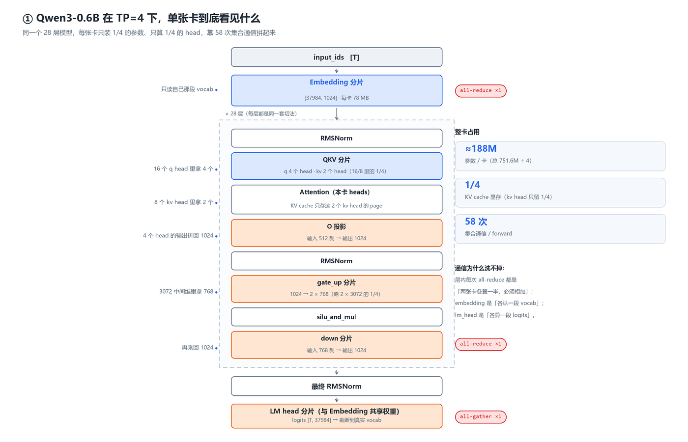

# read-mini-sglang

读 [sgl-project/mini-sglang](https://github.com/sgl-project/mini-sglang)（基线 `9a91cfa`）的**中文笔记**：
边跑边记 —— 环境怎么搭、显存怎么算、进程怎么起、张量并行怎么切。

> ⚠️ **这个仓库只有笔记，没有 mini-sglang 的源码。**
> 源码在本机 WSL 的 `~/workspace/mini-sglang`；给 AI 助手看的仓库说明见 [AGENTS.md](AGENTS.md)。



## 目录

| # | 文档 | 讲什么 | 图 |
|---|---|---|---|
| 01 | [环境配置与运行指南](01-WSL-Ubuntu24.04-mini-sglang-环境配置与运行指南.md) | WSL + Ubuntu 24.04 + CUDA 12.8 + uv 从零搭建；`start.sh` / `pull-model.sh` / `stop.sh`；显存与 KV cache 计算；HTTP 接口全表；一键复现 | 2 张 |
| 02 | [读懂一个模型目录（Qwen3-0.6B 实战）](02-手把手带你读懂一个模型目录-Qwen3-0.6B实战.md) | 逐文件拆模型目录：safetensors 头怎么读、`config.json` 字段之间的推导、词表四件套、`chat_template`、三个别搞混的「长度」 | — |
| 03 | [调试 main 进程启动](03sglang调试main进程启动.md) | 启动链路 7 步、进程拓扑与四条 ZMQ 通道、`ModelConfig` 逐字段解释、VSCode + debugpy 远程调试 | 2 张 |
| 04 | [张量并行 TP 是怎么切的](04-张量并行TP是怎么切的.md) | 只切三个维度（vocab / head / intermediate）；每层 2 次 all-reduce 的通信账本；权重怎么"切着加载"；与 vLLM / SGLang 的对应 | 7 张 |
| 05 | [page_table 与 TableManager 源码解析](05-page_table与TableManager源码解析.md) | 三张表（token_pool / page_table / kv_cache）的形状与关系；`TableManager` 21 行逐行；`page_table` 的四种读、两种写；KV 分配的五段生命周期 | 4 张 |
| — | [踩坑记录](踩坑记录.md) | 14 条，现象 / 根因 / 解法 / 验证四段式，开头带索引表 | — |

## 为什么这些结论可信

- 每篇都标了**代码基线 commit**，正文里的 `文件:行号` 都是**对照源码逐行核对**的（不是凭记忆写的）。
- 每条结论尽量标来源：哪次运行、哪条命令、哪段日志。
- 没验证的就明确标 **「待验证」**，验证过才改成「已确认」——比如 TP>1 的路径，因为本机只有一张卡，至今仍是待验证。

## 环境

| 项 | 值 |
|---|---|
| 平台 | Windows 11 + WSL2（Ubuntu 24.04.5 LTS） |
| GPU | RTX 3070，**8 GB**（sm_86） |
| 软件 | CUDA 12.8.93 · Python 3.12 · torch 2.9.1+cu128 · flashinfer 0.7.2 |
| 服务 | `0.0.0.0:8000`，WSL2 自动转发，Windows 侧用同一个 `localhost:8000` |

## 配图怎么来的

11 张示意图都是脚本画的（环境里没有 matplotlib，用 Pillow 手绘，画布 2 倍超采样再缩回，边缘不发虚）：

```bash
cd images
python _make_figs.py        # 重新生成全部
python _make_figs.py 3 5    # 只重画第 3、5 张
```

## 相关

- 上游项目：<https://github.com/sgl-project/mini-sglang>
- 笔记里用到的接口与命令都在 WSL 里实测过；命令块可以直接复制执行。
